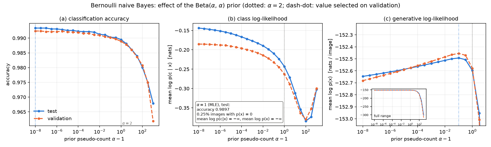
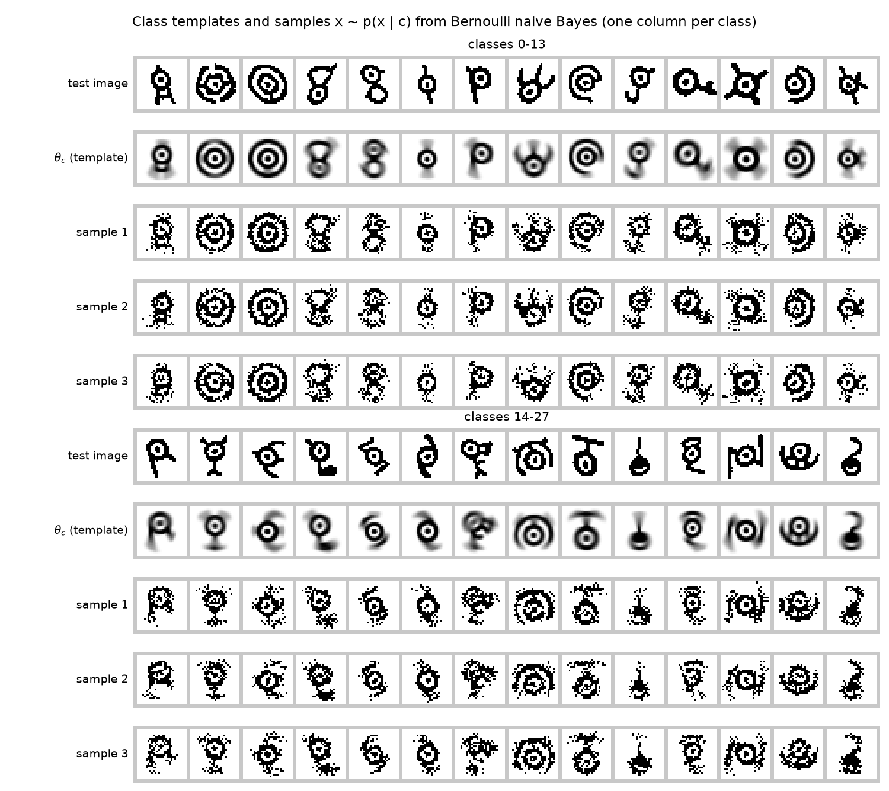
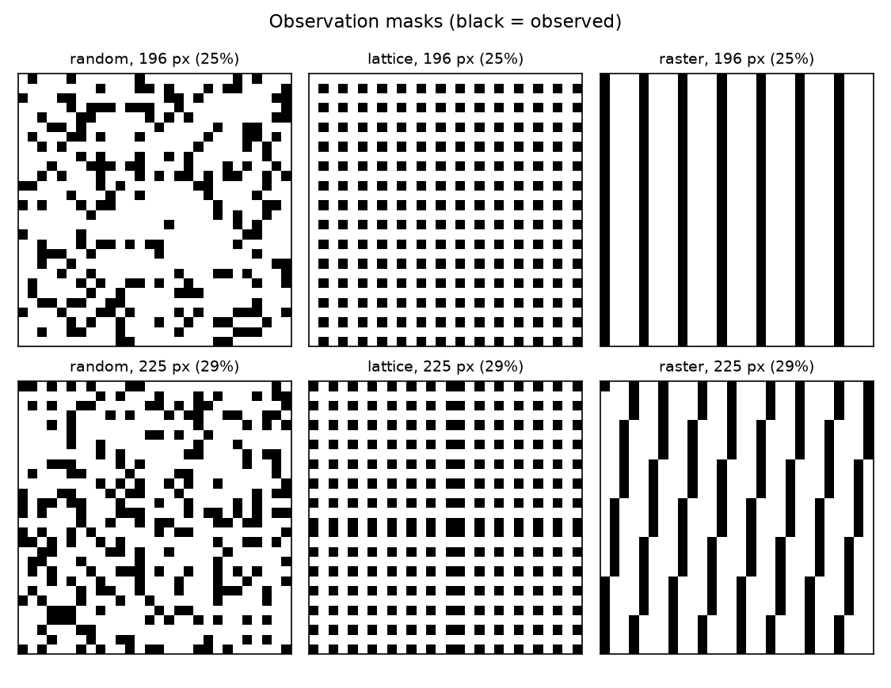
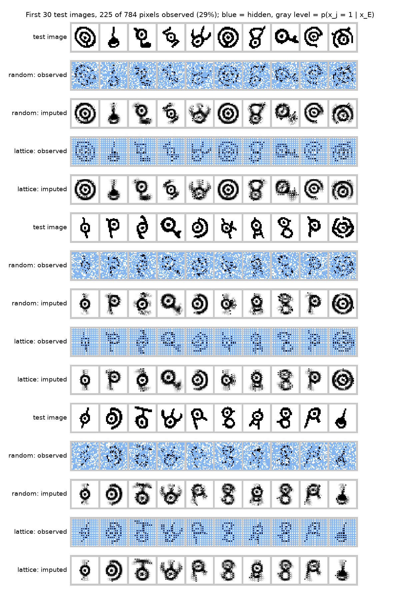
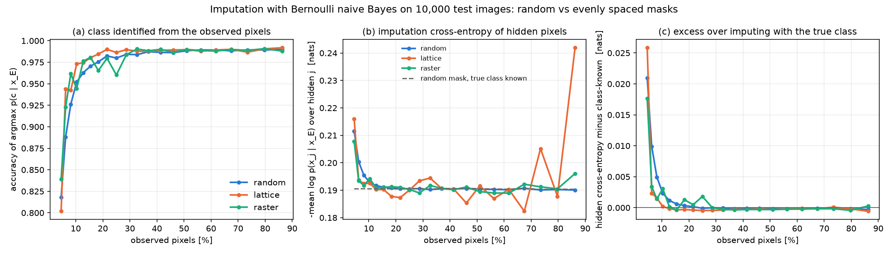
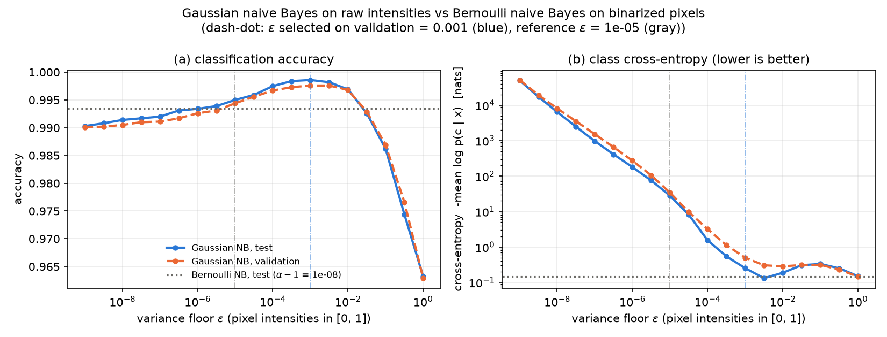

# Naive Bayes on Unown glyphs: classification, generation, and imputation

A model that treats the 784 pixels of a glyph as independent given its class is fitted to the 28-class Unown-MNIST data and used to classify, to sample, and to fill in hidden pixels. The Beta prior hardly changes accuracy (99.34% at pseudo-count $10^{-8}$, 98.95% with add-one), but without it (maximum likelihood) 0.25% of test images have probability zero under every class. Imputation matches "imputing with the true class" once about 13% of the pixels are seen, and more pixels do not help; an evenly spaced lattice of observed pixels identifies the class better than an equally large random mask (by 0.54 ± 0.11 points at 29% observed). Gaussian naive Bayes on raw intensities reaches 99.86% test accuracy.

## Question

What can a model that assumes pixels are conditionally independent given the class do on Unown glyphs? (1) What does the Beta prior add to maximum likelihood? (2) What do samples look like? (3) How well does it fill in missing pixels as the observed fraction grows, and do random or evenly spaced observations work better? (4) How does a Gaussian version on raw intensities compare?

## Model and methods

**Data.** 60,000 training and 10,000 test images of 28×28 pixels, 28 classes (about 2,140 training images each). Glyphs are bright strokes on a black background. A pixel is binarized as *on* ($x_j=1$) iff its uint8 intensity is at least 128, i.e. $x/255 > 0.5$; 20.58% of training pixels are on.

**Bernoulli naive Bayes.** $c \sim \mathrm{Cat}(\pi)$ and $x_j \mid c \sim \mathrm{Bernoulli}(\theta_{cj})$ independently for $j=1,\dots,784$. With independent $\mathrm{Beta}(\alpha,\alpha)$ priors on the $\theta_{cj}$, the posterior is $\mathrm{Beta}(N_{cj}+\alpha,\ N_c-N_{cj}+\alpha)$ and its mode (the MAP estimate, valid for $\alpha\ge 1$) is

$$\hat\theta_{cj} = \frac{N_{cj} + \alpha - 1}{N_c + 2(\alpha - 1)}, \qquad \hat\pi_c = \frac{N_c}{N},$$

where $N_c$ counts training images of class $c$ and $N_{cj}$ those among them with pixel $j$ on. $\alpha=1$ is the MLE; $\alpha-1$ acts as a pseudo-count added to both outcomes.

**Log-domain inference.** $\log p(x\mid c)=\sum_j x_j\log\theta_{cj}+(1-x_j)\log(1-\theta_{cj})$ is computed with the convention $0\cdot\log 0 = 0$, so an impossible pixel value gives $-\infty$ rather than NaN. Class posteriors are $\log p(c\mid x)=\log\pi_c+\log p(x\mid c)-\operatorname{logsumexp}_{c'}[\log\pi_{c'}+\log p(x\mid c')]$; when every class has probability zero the posterior is undefined and the image counts as an error.

**Sampling.** Ancestral: draw $c\sim\pi$, then each pixel independently from $\mathrm{Bernoulli}(\theta_{cj})$.

**Imputation.** Let $E$ be the observed pixels and $H$ the hidden ones. Hidden pixels marginalize out of $p(x\mid c)$, so $p(c\mid x_E)\propto \pi_c\prod_{i\in E}p(x_i\mid c)$ and

$$p(x_j=1\mid x_E)=\sum_c p(c\mid x_E)\,\theta_{cj}, \qquad p(x_H\mid x_E)=\sum_c p(c\mid x_E)\prod_{j\in H}p(x_j\mid c).$$

The imputed image keeps $x_E$ and shows $p(x_j=1\mid x_E)$ as a gray level for $j\in H$.

**Masks.** For an $m\times m$ *lattice*, rows and columns sit at $\lfloor (k+\tfrac12)\cdot 28/m\rfloor$, $k=0,\dots,m-1$. A *random* mask observes $m^2$ pixels drawn uniformly without replacement, independently for each image. A *raster* mask takes $m^2$ pixels evenly spaced in row-major order, which is "evenly spaced" in one dimension only (Figure 3).

**Gaussian naive Bayes.** On intensities in $[0,1]$, $x_j\mid c\sim\mathcal N(\mu_{cj},\sigma^2_{cj}+\varepsilon)$ with the per-class MLE mean and (1/N) variance. 40.26% of the $(c,j)$ variances are exactly zero (background pixels), so the floor $\varepsilon$ is required; it is added once.

## Experiments

- **Prior sweep.** $\alpha-1\in\{0\}\cup\{10^{-8},10^{-7.5},\dots,10^{3}\}$. Validation curves use a model fit on 50,000 training images and evaluated on the 10,000 held-out ones (split seed 0); test curves use a model fit on all 60,000 images. Metrics: accuracy, mean $\log p(c\mid x)$ of the true class, and mean $\log p(x)$ in nats per image.
- **Selection on validation.** The pseudo-count for classification maximizes validation accuracy, the one for generation and imputation validation $\log p(x)$. Gaussian $\varepsilon\in\{10^{-9},10^{-8.5},\dots,1\}$ maximizes validation accuracy.
- **Samples.** 3 per class from $p(x\mid c)$, plus 10,000 ancestral samples to compare a local statistic with the test images.
- **Imputation.** All 10,000 test images, $m=6,\dots,26$ (4.6% to 86.2% observed), three mask types with $m^2$ observed pixels each. Averaged over each image's hidden pixels: the cross-entropy $-\log p(x_j\mid x_E)$; the class-known reference $-\log p(x_j\mid c)$, the best naive Bayes can do on those pixels; their difference ("excess"); and the error of thresholding $p(x_j=1\mid x_E)$ at 0.5. Also the accuracy of $\arg\max_c p(c\mid x_E)$. Mask comparisons are paired over images, with standard errors over images.

## Results

### The prior matters for probabilities, not for ranking



*Figure 1. Test (solid) and validation (dashed) metrics against the pseudo-count $\alpha-1$. Values at $\alpha=1$ cannot be drawn on the log axis and are given in the box.*

| prior (test set, fit on 60,000 images) | $\alpha-1$ | accuracy | mean $\log p(c\mid x)$ | mean $\log p(x)$ |
|---|---|---|---|---|
| MLE | 0 | 0.9897 | $-\infty$ | $-\infty$ |
| best validation accuracy | 1e-08 | 0.9934 | −0.1438 | −152.6467 |
| best validation $\log p(x)$ | 0.1 | 0.9903 | −0.2095 | −152.4928 |
| add-one ($\alpha=2$) | 1 | 0.9895 | −0.2431 | −152.5982 |
| strong ($\alpha=1001$) | 1000 | 0.9679 | −0.3025 | −301.8541 |

The MLE sets 10,095 of the 21,952 parameters to exactly 0 and 65 to exactly 1. On the test set, 25 images have probability zero under every class (posterior undefined) and 25 more under their true class, so both average log-likelihoods are $-\infty$. Accuracy, however, is 98.97%, as with the add-one prior. Any $\alpha>1$ removes the zeros, and accuracy and class log-likelihood keep improving, almost monotonically, as $\alpha\to 1^+$: $\log\theta\approx\log((\alpha-1)/N_c)$ becomes a large penalty for ink where a class never has ink, which on these clean glyphs is informative. The generative log-likelihood peaks at $\alpha-1=0.1$. Strong priors pull every $\theta$ toward 1/2 and lose on all three.

### Samples have the right ink density but no strokes



*Figure 2. Per class: a test image, the template $\hat\theta_c$, and three samples from $p(x\mid c)$ ($\alpha-1=0.1$). On-pixels are drawn black.*

The templates are recognizable glyphs, blurred by the shifts and distortions in the data. Samples reproduce the ink rate (20.57% vs 20.58% in test images) but scatter it: 5.25% of the on-pixels in 10,000 ancestral samples have none of their four neighbors on, versus 1.86e-06 in test images. Independent pixels cannot form connected strokes.

### Imputation: the class is all the model can use



*Figure 3. The three mask types at 196 and 225 observed pixels. At 196 pixels (every 4th pixel in raster order) the raster mask degenerates into 7 whole columns.*



*Figure 4. The first 30 test images with 225 of 784 pixels (29%) observed, by a random mask (different per image) and by the 15×15 lattice. Blue: hidden. Imputed pixels show $p(x_j=1\mid x_E)$.*



*Figure 5. (a) Accuracy of the class read off $p(c\mid x_E)$. (b) Hidden-pixel cross-entropy; dashed: the same pixels imputed with the true class. (c) Cross-entropy in excess of that class-known reference.*

| observed pixels | class accuracy random / lattice / raster | hidden cross-entropy (nats) random / lattice | excess over class-known random / lattice | hidden pixel error, random |
|---|---|---|---|---|
| 36 (4.6%) | 0.8180 / 0.8018 / 0.8392 | 0.2115 / 0.2160 | 0.0210 / 0.0258 | 0.0983 |
| 64 (8.2%) | 0.9262 / 0.9424 / 0.9618 | 0.1955 / 0.1924 | 0.0049 / 0.0015 | 0.0920 |
| 100 (12.8%) | 0.9629 / 0.9744 / 0.9763 | 0.1917 / 0.1902 | 0.0012 / −0.0001 | 0.0907 |
| 196 (25.0%) | 0.9799 / 0.9864 / 0.9603 | 0.1905 / 0.1900 | −0.0001 / −0.0005 | 0.0904 |
| 225 (28.7%) | 0.9842 / 0.9896 / 0.9838 | 0.1906 / 0.1934 | 0.0000 / −0.0004 | 0.0905 |
| 400 (51.0%) | 0.9884 / 0.9896 / 0.9899 | 0.1904 / 0.1916 | −0.0002 / −0.0003 | 0.0905 |
| 676 (86.2%) | 0.9899 / 0.9919 / 0.9880 | 0.1901 / 0.2419 | −0.0003 / −0.0006 | 0.0906 |

With nothing observed, the hidden-pixel cross-entropy is 0.3498 nats (random masks, 36 pixels); with the true class known it is 0.1905. Random masks close this gap by about 13% observed. From there to 86%, the cross-entropy (0.1901–0.1917 nats) and pixel error (0.0904–0.0907) stay flat. The excess even turns slightly negative: the posterior can mix in a class whose template fits a given image better than its own class's.

**Random vs evenly spaced.** With equal pixel counts, the paired difference in class accuracy (random minus lattice) is +0.0162 ± 0.0051 at 36 pixels, where random masks win, but negative at every size from 49 to 256 pixels (6–33%): −0.0554 ± 0.0036 at 49, −0.0115 ± 0.0020 at 100, −0.0054 ± 0.0011 at 225. From 289 pixels on the two are within 0.31 points. At 225 pixels the lattice's excess cross-entropy is lower by 0.0004 ± 0.0001 nats, a difference invisible in Figure 4. The large raw cross-entropy of the lattice at 86% observed (0.2419) is a property of *which* pixels are hidden: the 26×26 lattice hides rows 6 and 20 and columns 6 and 20, which cut through the glyphs, and the class-known reference on those pixels is just as high (0.2425).

### Gaussian vs Bernoulli naive Bayes



*Figure 6. Gaussian naive Bayes against the variance floor $\varepsilon$; dotted: Bernoulli naive Bayes at $\alpha-1=10^{-8}$ (test).*

| model (test set) | accuracy | mean $\log p(c\mid x)$ |
|---|---|---|
| Bernoulli, $\alpha-1=10^{-8}$ (selected) | 0.9934 | −0.1438 |
| Gaussian, $\varepsilon=10^{-3}$ (selected) | 0.9986 | −0.2513 |
| Gaussian, $\varepsilon=10^{-5}$ | 0.9950 | −27.8952 |
| Gaussian, $\varepsilon=1$ (lowest validation cross-entropy) | 0.9632 | −0.1490 |

The intensities carry information that binarization discards (anti-aliased stroke edges), and the Gaussian model uses it: 99.86% against 99.34%. Its probabilities, though, hinge on $\varepsilon$. A stray stroke pixel where a class has zero variance costs $x^2/(2\varepsilon)$ nats, so at $\varepsilon=10^{-5}$ the few errors are wrong by thousands of nats and the mean class log-likelihood is −27.9 despite 99.50% accuracy.

## Discussion

**What the model can and cannot do.** Conditional independence is enough to *rank* classes, but not to produce believable images, and it caps imputation: $x_E$ affects a hidden pixel only through $p(c\mid x_E)$. Once the class is pinned down the imputation is the class template, about 9% of hidden pixels are wrong, and further observations are ignored. Using stroke continuity or the exact shift of a glyph needs dependencies between pixels: a mixture of Bernoullis with many components per class, a Markov random field, or a deep generative model.

**Prior.** For classification the prior is a numerical device that keeps probabilities nonzero, and here the smaller the pseudo-count the better. The $\alpha\to 1^+$ limit first counts each class's "impossible" pixels, so it is not the MLE classifier, which leaves 0.25% of test images undefined. For density estimation a moderate pseudo-count (0.1) is best. Both conclusions rely on test images produced by the same augmentation process as the training images; on messier data, harsh penalties for unseen ink would likely hurt.

**Overconfidence.** Treating 784 correlated pixels as independent evidence makes posteriors far too sharp, so the mean class log-likelihood is driven by a handful of confident errors. In the Gaussian model a large $\varepsilon$ works like a temperature: at $\varepsilon=1$ the cross-entropy is lower than at the accuracy-optimal $\varepsilon$, while accuracy drops to 96.32%.

**Methodological pitfalls.**
- Evaluating $x\log\theta+(1-x)\log(1-\theta)$ literally with $\theta=0$ gives $0\cdot(-\infty)=\mathrm{NaN}$. Every class has such background pixels, so every row becomes NaN, `argmax` returns class 0, and the "MLE accuracy" comes out as 0.0333, exactly the frequency of class 0. The real MLE accuracy is 0.9897.
- Imputing with the template of a single class drawn from $p(c\mid x_E)$, instead of averaging over it, raises the hidden cross-entropy from 0.2115 to 0.2633 at 36 random pixels (0.1906 to 0.1912 at 225).
- Normalize posteriors with logsumexp; adding a small constant inside the log hides confident errors.
- "Evenly spaced in raster order" is not a 2-D grid. At 196 pixels it gives stripes and 96.03% class accuracy against 98.64% for the lattice.
- The joint $\log p(x_H\mid x_E)$ per hidden pixel is nearly constant (about −0.190) at every observed fraction: it can exceed its nothing-observed value by at most $-\log\min_c\pi_c\approx 3.3$ nats in total, under 0.005 nats per pixel. Per-pixel marginals are the informative measure.

**Limitations.** The lattice is a single fixed pattern, so its curve is jagged: alignment with strokes changes with $m$, and 36 pixels is an unlucky size. Each test image gets one random mask, and standard errors are over images. The selected pseudo-count lies at the edge of the grid. Below about $10^{-12}$ the pseudo-count is lost in rounding ($N_c+\alpha-1$ rounds to $N_c$), so $1-\hat\theta$ becomes 0 in double precision. The binarization threshold was not tuned.

## Reproduce

```bash
cd projects/01-naive-bayes-unown
python run.py                 # all figures/ and results/, about 54 s on an Apple-silicon laptop CPU
python -m pytest -q tests     # 16 checks against brute force, grid search, and scipy
```

`run.py --help` lists every setting (seed, grids, mask sizes). All numbers above come from `results/summary.json` and the three sweep CSVs in `results/`. The tests compare the MAP formula with a grid search over the Beta posterior, posteriors with Bayes' rule in probability space, imputation and $p(x_H\mid x_E)$ with enumeration of all $2^4$ images of a 4-pixel, 3-class model, the sampler with model frequencies, and Gaussian naive Bayes with per-class moments and `scipy.stats.norm`.

## Related notes

In the [lecture notes](../../notes/STA314_STA414_Statistical_ML_Lecture_Notes.pdf):
- Chapter 2: maximum likelihood, MAP estimation, and the Beta–Bernoulli example that gives the formula for $\hat\theta$.
- Chapter 7: generative classifiers and naive Bayes, Gaussian naive Bayes as QDA with diagonal covariances.
- Chapter 12: naive Bayes as the simplest directed graphical model; conditional independence given the class, and the dependence between pixels it induces once the class is marginalized out.
- Chapter 16: latent-variable models, where the class becomes unobserved and a mixture of Bernoullis is the natural next step for imputation.
