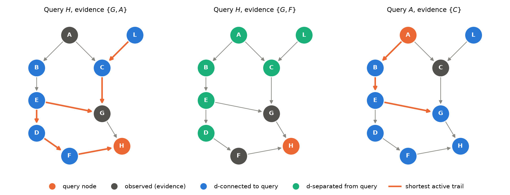
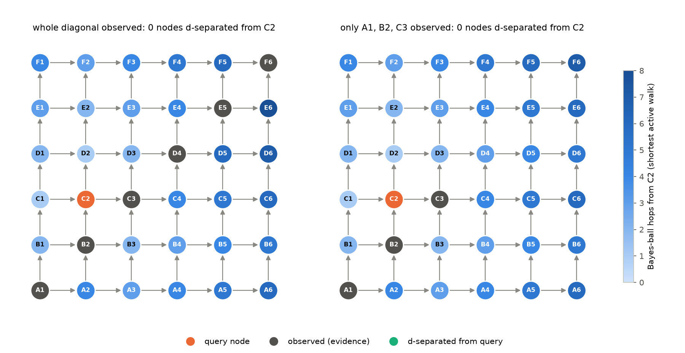
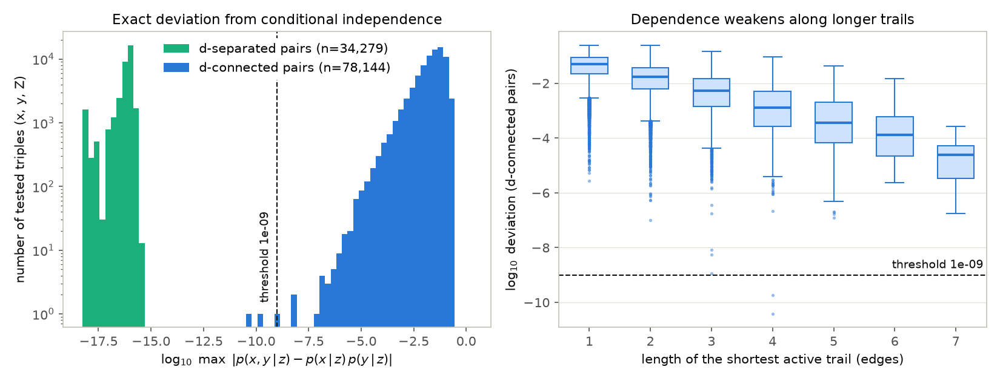

# Reading conditional independence off a graph, and checking it numerically

Which variables in a Bayesian network are conditionally independent of a query node for *every* choice of conditional probability tables? We implement d-separation twice (linear-time Bayes-ball reachability and exhaustive trail enumeration) and check both against exact joints of binary networks with random tables. On a nine-node network, no unobserved node is independent of $H$ given $\{G, A\}$, all six are independent of $H$ given $\{G, F\}$, and $A$ stays dependent on $G$ given $C$. On a lattice whose diagonal is observed, no unobserved node is independent of $C_2$. On 20,000 queries over 4,000 random DAGs the algorithms always agree, and the exact deviation from independence is at most $3.3\times10^{-16}$ on all 34,279 d-separated pairs and at least $3.8\times10^{-11}$ on all 78,144 d-connected pairs.

## Question

A DAG $G$ over $x_1,\dots,x_n$ encodes the factorization $p(x)=\prod_i p(x_i\mid x_{\mathrm{pa}(i)})$. Given a query node $x$ and an evidence set $Z$, we want every node $y$ with $x\perp y\mid Z$ in all distributions that factorize over $G$. d-separation answers this: d-separated pairs are independent in every such distribution (soundness), and d-connected pairs are dependent for all parameters outside a set of measure zero (Meek, 1995). We study:

1. The nine-node network
   $$p(A,B,C,D,E,F,G,H,L)=p(A)\,p(L)\,p(B\mid A)\,p(C\mid A,L)\,p(E\mid B)\,p(G\mid C,E)\,p(D\mid E)\,p(F\mid D)\,p(H\mid G,F),$$
   with three queries: $H$ given $\{G,A\}$, $H$ given $\{G,F\}$, and $A$ versus $G$ given $C$.
2. An infinite lattice with nodes $(r,c)$, $r,c\ge 1$, edges $(r,c)\to(r,c+1)$ and $(r,c)\to(r+1,c)$, and the diagonal $\{(k,k)\}$ observed. Rows are named $A, B, C,\dots$ from the bottom and columns are numbered, so $C_2=(3,2)$. The query is which unobserved nodes are independent of $C_2$.
3. Random DAGs, used as a stress test of the algorithms and of the numerical test.

## Model and methods

**Active triples.** A trail (a path in the skeleton that does not repeat nodes) is *active* given $Z$ if every consecutive triple $a - m - b$ on it is active. A chain $a\to m\to b$ or a fork $a\leftarrow m\to b$ is active iff $m\notin Z$. A collider $a\to m\leftarrow b$ is active iff $m$ or one of its descendants is in $Z$. $x$ and $y$ are d-separated by $Z$ iff no trail between them is active.

**(a) Bayes ball** (`src/dsep.py::reachable`; Koller and Friedman, Algorithm 3.1). Phase 1 collects $\mathrm{An}(Z)$, the evidence and its ancestors. A collider $m$ is active exactly when $m\in\mathrm{An}(Z)$. Phase 2 runs a breadth-first search over states $(v,\uparrow)$ ("arrived from a child") and $(v,\downarrow)$ ("arrived from a parent"), starting at $(x,\uparrow)$:

- $(v,\uparrow)$, $v\notin Z$: continue to all parents $(\cdot,\uparrow)$ and all children $(\cdot,\downarrow)$;
- $(v,\downarrow)$, $v\notin Z$: continue to all children $(\cdot,\downarrow)$;
- $(v,\downarrow)$, $v\in\mathrm{An}(Z)$: bounce back to all parents $(\cdot,\uparrow)$ (an active collider).

Every unobserved node that is visited is d-connected to $x$. The run time is $O(|V|+|E|)$, and the BFS depth gives the length of the shortest active walk ("hops").

**(b) Trail enumeration** (`active_trails_bruteforce`). A depth-first search lists every trail from $x$, extending it only while the newest triple is active, with colliders checked against explicit descendant sets. It shares no code with (a), is exponential in the worst case, and returns a shortest active trail per d-connected node.

**(c) Exact numerical test** (`src/numeric.py`). All variables are binary. Each table entry $p(x_i=1\mid \text{parents})$ is drawn i.i.d. from Uniform(0,1), and the joint is built by enumerating all $2^n$ states. For a pair $(x,y)$ and evidence $Z$ we compute

$$\Delta(x,y\mid Z)=\max_{a,b,z:\,p(z)>0}\ \bigl|p(x{=}a,y{=}b\mid z)-p(x{=}a\mid z)\,p(y{=}b\mid z)\bigr| .$$

Soundness gives $\Delta=0$, up to rounding, for d-separated pairs. For d-connected pairs $\Delta>0$ with probability one under random tables. We call a pair numerically independent if $\Delta<10^{-9}$, a threshold fixed before running anything.

## Experiments

- **Nine-node network.** We run each query with (a), (b) and (c), using 200 random table draws (seed 0). A pair counts as numerically independent only if $\Delta<10^{-9}$ in every draw.
- **Explaining away.** We keep the collider $A\to C\leftarrow L$ and set $p(A{=}1)=p(L{=}1)=0.2$ with a noisy-OR $p(C{=}1\mid A,L)=1-0.95\cdot 0.2^{A+L}$. All other tables are random (seed 0).
- **Lattice.** We use $n\times n$ truncations for $n=3,\dots,20$. There are two readings of the evidence: the whole diagonal $\{(k,k): k\le n\}$, and only the first three diagonal nodes $A_1,B_2,C_3$. We query $C_2$ and also all pairs of unobserved nodes. Trail enumeration cross-checks all sources for $n\le 5$. The numerical check uses the $4\times4$ lattice (16 nodes, 65,536 states) with 20 draws (seed 1).
- **Stress test.** We draw 4,000 random DAGs (seed 2). Each has $n\sim\mathrm{Unif}\{4,\dots,12\}$ nodes, a random order, and each forward edge present with probability $\mathrm{Unif}(0.15,0.6)$. Each DAG gets one random table draw and 5 queries, each with a random source $x$ and $|Z|\sim\mathrm{Unif}\{0,\dots,3\}$. All three methods are compared on every remaining node $y$.

## Results

### Nine-node network



*Figure 1. Node roles for the three queries. The thick orange edges are a shortest active trail: $H\leftarrow F\leftarrow D\leftarrow E\to G\leftarrow C\leftarrow L$ (left, to the farthest d-connected node) and $A\to B\to E\to G$ (right).*

| query | d-separated from the query (Bayes ball = enumeration = numerics) |
|---|---|
| $H$ given $\{G, A\}$ | $\varnothing$: all of $B, C, D, E, F, L$ are d-connected |
| $H$ given $\{G, F\}$ | $\{A, B, C, D, E, L\}$ |
| $A$ given $\{C\}$ | $\varnothing$; in particular $A\not\perp G\mid C$ |

**$H$ given $\{G,A\}$.** Observing $G$ blocks $H\leftarrow G$, but the chain $H\leftarrow F\leftarrow D\leftarrow E$ stays open. From $E$ it continues as a chain to $B$, and through the observed collider $E\to G\leftarrow C$ to $C$ and $L$. The median $\Delta$ over the 200 draws falls with distance: 0.092 ($F$), 0.024 ($D$), 0.0055 ($E$), 0.0013 ($B$), 0.0011 ($C$), 0.00027 ($L$). The independent set is therefore empty.

**$H$ given $\{G,F\}$.** Both parents of $H$ are observed and $H$ has no children, so every trail from $H$ starts with an observed chain node and is blocked. Over all 200 draws, $\Delta\le 2.2\times10^{-16}$ for all six nodes.

**$A$ versus $G$ given $C$, from the factorization.** Summing out $H, F, D$ (leaf-first) and then $L$ via $\sum_L p(L)\,p(C\mid A,L)=p(C\mid A)$ gives
$$p(A,C,G)=p(A)\,p(C\mid A)\,p(G\mid A,C),\qquad p(G\mid A,C)=\sum_{B,E}p(B\mid A)\,p(E\mid B)\,p(G\mid C,E),$$
so $p(A\mid C,G)=p(A\mid C)\,p(G\mid A,C)/p(G\mid C)$. This equals $p(A\mid C)$ iff $p(G\mid A,C)$ does not depend on $A$. Nothing in the factorization forces that. With the seed-0 tables, the sum formula and the enumerated joint agree to machine precision: $p(G{=}1\mid A{=}0,C{=}0)=0.3608$ and $p(G{=}1\mid A{=}1,C{=}0)=0.3686$. Hence $p(A{=}1\mid C{=}0,G{=}1)=0.8015\ne p(A{=}1\mid C{=}0)=0.7981$. The graphical reason is the active chain $A\to B\to E\to G$. Observing $C$ also opens $A\to C\leftarrow L$, so $L$ becomes dependent on $A$ as well.

### Explaining away on $A\to C\leftarrow L$

| quantity | value |
|---|---|
| $p(A{=}1)$ | 0.2000 |
| $p(A{=}1\mid L{=}1)$ | 0.2000 |
| $p(A{=}1\mid C{=}1)$ | 0.5098 |
| $p(A{=}1\mid C{=}1, L{=}0)$ | 0.8020 |
| $p(A{=}1\mid C{=}1, L{=}1)$ | 0.2289 |

$A$ and $L$ are independent a priori ($\Delta=0$ exactly). Seeing $C=1$ raises $p(A{=}1)$ from 0.20 to 0.51; learning that the other cause $L$ is present explains the observation away (back to 0.23), while its absence makes $A$ the likely cause (0.80). Hence $\Delta(A,L\mid C)=0.143$. Observing only $H$, a descendant of $C$ via $G$, also opens the collider: $\Delta(A,L\mid H)=5.5\times10^{-4}$, small but nonzero.

### Lattice with observed diagonal



*Figure 2. $6\times6$ truncation. Each unobserved node is colored by its Bayes-ball distance from $C_2$. Left: whole diagonal observed. Right: only $A_1, B_2, C_3$ observed. No node is d-separated from $C_2$ in either case.*

Two facts settle the infinite lattice. (i) Every node $(r,c)$ has an observed descendant, namely $(m,m)$ with $m=\max(r,c)$. So every collider on every trail is active, and a trail can only be blocked by passing a diagonal node as a chain or fork. (ii) The unobserved nodes form two regions, $r>c$ (which contains $C_2$) and $r<c$. Each region is connected and contains no observed node, so every trail inside a region is active. The regions are joined by the observed collider $B_1\to B_2\leftarrow A_2$. For example, $C_2\leftarrow C_1\leftarrow B_1\to B_2\leftarrow A_2\to A_3\to A_4$ is active. Hence **no unobserved node is independent of $C_2$**, and in fact no two unobserved nodes are independent of each other. A d-connection found in a truncation also holds in the infinite lattice. Enlarging the lattice only adds descendants (which open colliders) and trails, and the newly observed diagonal nodes lie off the old trails. So the d-connected set can only grow with $n$.

The computation agrees (`results/lattice_truncations.csv`):

| $n$ | evidence | unobserved nodes | d-connected to $C_2$ | d-separated from $C_2$ | d-separated unobserved pairs |
|---|---|---|---|---|---|
| 3 | whole diagonal | 6 | 5 | 0 | 0 |
| 5 | whole diagonal | 20 | 19 | 0 | 0 |
| 10 | whole diagonal | 90 | 89 | 0 | 0 |
| 20 | whole diagonal | 380 | 379 | 0 | 0 |
| 20 | $A_1,B_2,C_3$ only | 397 | 396 | 0 | 0 |

The answer is $\varnothing$ for every $n$ from 3 to 20 under both readings (with only $A_1,B_2,C_3$ observed, distant colliders close, but chains such as $A_2\to A_3\to\cdots$ keep everything connected). Trail enumeration agrees for every source when $n\le5$. On the $4\times4$ lattice the smallest $\Delta(C_2,y\mid\text{evidence})$ over all nodes and 20 draws is $2.7\times10^{-4}$ (whole diagonal) and $1.1\times10^{-4}$ (three observed nodes).

### Random-DAG stress test



*Figure 3. Left: exact deviation $\Delta$ for 112,423 tested triples $(x,y,Z)$, split by d-separation status (exact zeros are drawn at $10^{-18}$). Right: $\Delta$ for d-connected pairs against the length of their shortest active trail.*

| check | result |
|---|---|
| Bayes ball = trail enumeration (whole d-separated set per query) | 20,000 / 20,000 queries |
| same, per pair | 112,423 / 112,423 |
| largest $\Delta$, d-separated pairs (34,279) | $3.3\times10^{-16}$ |
| smallest $\Delta$, d-connected pairs (78,144) | $3.8\times10^{-11}$ |
| numerical test at $10^{-9}$ agrees with d-separation | 112,421 / 112,423 pairs |

The two graph algorithms never disagree. The numerical test misses two d-connected pairs, with $\Delta=1.8\times10^{-10}$ and $3.8\times10^{-11}$, both with a shortest active trail of 4 edges. Another 25 d-connected pairs have $\Delta<10^{-6}$. The median $\Delta$ falls steadily with trail length: 0.049, 0.017, 0.0053, 0.0013, $3.6\times10^{-4}$, $1.3\times10^{-4}$ and $2.4\times10^{-5}$ for lengths 1 to 7.

## Discussion

**Why dependence decays along trails.** For a binary chain $x\to m\to y$,
$p(y{=}1\mid x{=}1)-p(y{=}1\mid x{=}0)=\bigl[p(m{=}1\mid x{=}1)-p(m{=}1\mid x{=}0)\bigr]\bigl[p(y{=}1\mid m{=}1)-p(y{=}1\mid m{=}0)\bigr]$.
Each edge multiplies the effect by a difference of two Uniform(0,1) entries, whose absolute value has mean $1/3$. Dependence therefore shrinks roughly geometrically along a trail, which matches the factor of 3–4 per edge in Figure 3. Completeness is a statement about *generic* parameters, and generic dependence can be arbitrarily weak: any threshold in $(3.3\times10^{-16}, 3.8\times10^{-11}]$ would have been perfect on this sample, but no fixed threshold is safe in general. Even in the nine-node network one of 200 draws gives $\Delta(H,L\mid G,A)=5.7\times10^{-10}$. Numerics confirm d-separation reliably, and d-connection only when the dependence is large enough to see.

**Pitfalls.**
- *The independent set is the complement of the reachable set.* Given $\{G,A\}$ all six unobserved nodes are reachable from $H$, so the set *independent* of $H$ is empty. It is easy to write the reachable set where the independent set belongs, or to miss a node reached by a plain chain ($B$ here).
- *A collider opens when any descendant is observed.* $A$ and $L$ become dependent given $H$, two edges below $C$.
- *Being a descendant does not imply dependence.* Given $\{G,F\}$, $H$ is a descendant of every other node and independent of all of them; the lattice argument must go through active trails (every node has an observed descendant).
- *Showing dependence from a factorization needs a witness.* Writing $p(A\mid C)\,p(G\mid A,C)/p(G\mid C)$ "$\neq p(A\mid C)$" is not a proof: equality holds for special tables (e.g. $p(E\mid B)$ constant in $B$). The proof is a concrete table set where it fails, as above.

**Limitations.** The numerical check enumerates $2^n$ states, so it covers networks of up to about 20 binary nodes. Trail enumeration is exponential in the worst case. The random-DAG distribution (uniform order, Bernoulli edges, $\le12$ nodes) produced shortest active trails of at most 7 edges, so very long-range dependence is not exercised.

## Reproduce

```bash
cd projects/02-d-separation
python run.py              # full run, about 25 s on an Apple-silicon laptop
python run.py --quick      # smoke run, about 1 s
python -m pytest -q tests  # 26 tests, under 1 s
```

`run.py` writes `figures/*.png`, `results/*.json` and `results/lattice_truncations.csv`, with fixed seeds (`--seed`, default 0); sizes are options (`--n-dags`, `--max-nodes`, `--param-draws`, `--lattice-max`, `--tol`, ...).

## Related notes

- Chapter 12 of the [lecture notes](../../notes/STA314_STA414_Statistical_ML_Lecture_Notes.pdf), section "Reading Independences from a DAG: d-Separation": the three triple rules, explaining away, the Bayes-ball procedure, and the soundness/completeness theorem tested here.
- Chapter 13, "Inference Queries": the brute-force marginalization used in the numerical test is the baseline that variable elimination improves on.

References: D. Koller and N. Friedman, *Probabilistic Graphical Models* (2009), Sec. 3.3; C. Meek, "Strong completeness and faithfulness in Bayesian networks", UAI 1995.
