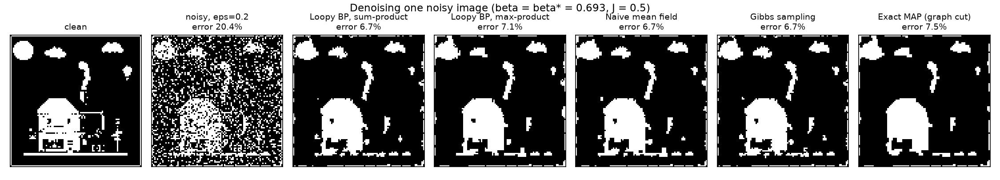
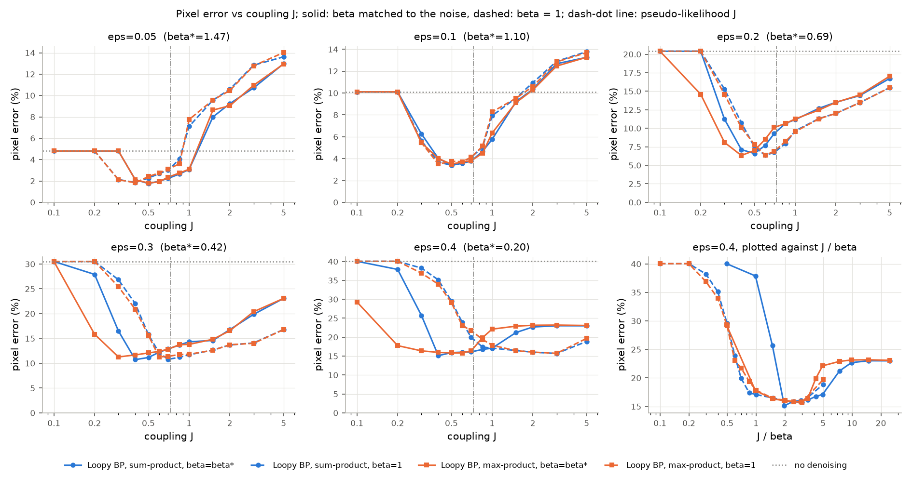
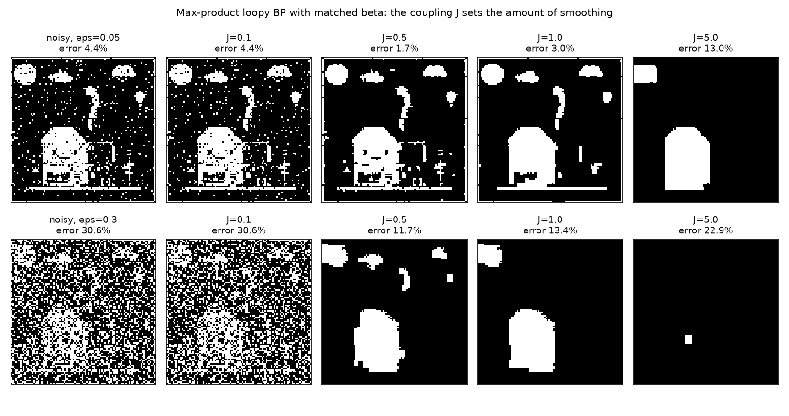
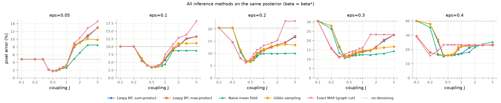
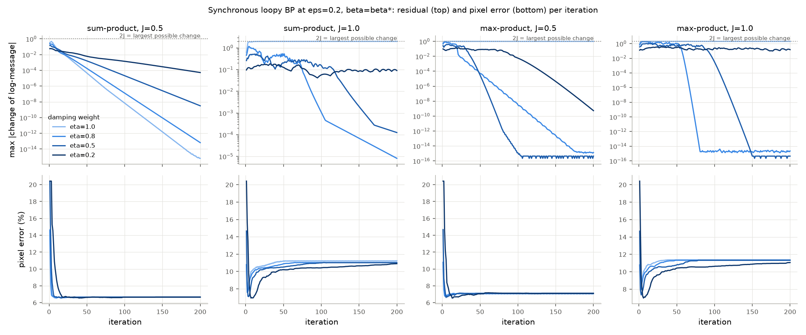
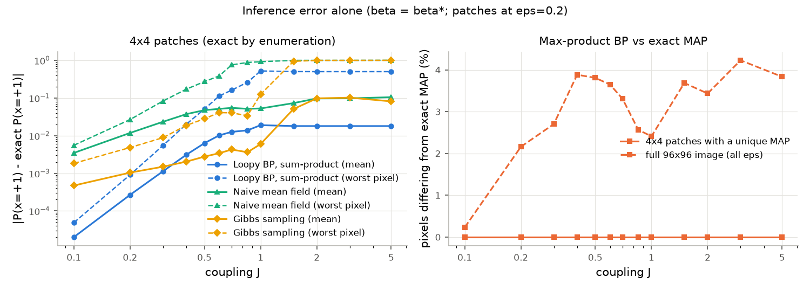

# Loopy belief propagation for binary image denoising: setting the coupling and the evidence strength

We denoise a 96×96 binary image corrupted by symmetric flip noise using an Ising posterior and vectorized log-domain loopy belief propagation (sum-product and max-product, with damping). On the same posterior we compare it with naive mean field, Gibbs sampling, and the exact MAP from a graph cut. When the evidence strength matches the noise, $\beta^\ast=\tfrac12\log\frac{1-\epsilon}{\epsilon}$, the best coupling for BP stays in $J\in[0.3,0.6]$ for every flip rate from 0.05 to 0.4. Loopy BP then cuts the pixel error from 20.4% to 6.6% at $\epsilon=0.2$. With $\beta$ fixed at 1, the best $J$ drifts from 0.4 to 3.0. $J$ matters far more than the inference method: at their best $J$ all five methods are within 0.7 percentage points of each other, while $J=5$ adds about 10 points.

## Question

How well does loopy BP denoise a binary image, and how should the neighbor coupling $J$ and the evidence strength $\beta$ be set? Also: what does damping do, how do sum- and max-product compare, and how far are the approximations from exact inference?

## Model and methods

**Posterior.** Pixels $x_i\in\{-1,+1\}$ (+1 = white) sit on a grid with 4-neighbor edges $E$. Each pixel is flipped independently with probability $\epsilon$, which gives the observation $y$, and

$$p(x\mid y)\propto\exp\Big(\beta\sum_i y_ix_i+J\sum_{(i,j)\in E}x_ix_j\Big).$$

The flip likelihood ($1-\epsilon$ if $y_i=x_i$, else $\epsilon$) equals $e^{\beta x_iy_i}/(2\cosh\beta)$ exactly when $\beta=\beta^\ast$. So the noise fixes $\beta$, while $J$ belongs to the prior and describes the clean image.

**Loopy BP.** Messages are normalized two-vectors, stored as log-probabilities in four direction arrays of shape $H\times W\times2$. One synchronous iteration recomputes every directed edge from the previous messages,

$$\tilde m_{j\to i}(x_i)=\operatorname*{R}_{x_j}\ e^{Jx_ix_j}\,e^{\beta y_jx_j}\prod_{k\in N(j)\setminus i}m_{k\to j}(x_j),\qquad \operatorname{R}\in\{\textstyle\sum,\max\}.$$

Each new message is normalized to sum to one and then damped, $m\leftarrow\eta\,\tilde m+(1-\eta)\,m$. This is a convex combination of two normalized messages, and $\eta=1$ is plain BP. The default is $\eta=0.5$. Iteration stops when no log-message changes by more than $10^{-4}$, or after 300 iterations. Beliefs are $b_i(x_i)\propto e^{\beta y_ix_i}\prod_{j\in N(i)}m_{j\to i}(x_i)$. Sum-product thresholds $b_i(+1)$ at 1/2, which is the posterior-marginal rule and minimizes the expected number of wrong pixels. Max-product takes the argmax of the max-marginals, which is the MAP rule. Exact ties keep the observed pixel.

**Comparison methods on the same posterior.**
- *Naive mean field:* $\mu_i\leftarrow\tanh(\beta y_i+J\sum_{j\in N(i)}\mu_j)$, one checkerboard color at a time. This is exact coordinate ascent, so the ELBO never decreases. Starts at $\tanh(\beta y_i)$; decides by $\operatorname{sign}\mu_i$.
- *Gibbs sampling:* checkerboard sweeps from $y$, with 200 burn-in and 1,000 kept sweeps. Posterior means use the Rao-Blackwellized average of $\tanh(\beta y_i+J\sum_jx_j)$.
- *Exact MAP:* for $J\ge0$ the MAP is a minimum s-t cut (Greig, Porteous and Seheult, 1989). We solve it with scipy's max-flow on capacities scaled to integers.
- *No denoising:* $\hat x=y$.

**A non-oracle $J$.** Fitting the field-free Ising prior to the clean image by maximum pseudo-likelihood, $\arg\max_J\sum_i\log\sigma(2Jx_i\sum_{j\in N(i)}x_j)$, gives $\hat J_{\rm PL}=0.727$.

**Verification** (`tests/`, 24 pytest checks):
- *Trees.* Sum-product BP on a spanning tree of a 3×4 grid matches brute-force marginals to $10^{-10}$, damped or not. Max-product on chains gives the exact max-marginals and MAP.
- *Loopy grids.* On 3×3 grids with $J=0.3$, BP marginals are within 0.02 of brute force, but not exact.
- *Implementation.* The vectorized update matches a naive neighbor-list loop. Messages stay normalized. Damping is the stated convex combination and keeps fixed points.
- *Other methods.* Graph cut equals the brute-force MAP. Mean field reaches its fixed point with a monotone ELBO below $\log Z$. Gibbs matches exact marginals. Pseudo-likelihood recovers $J$ from Ising samples.

## Experiments

**Data.** We take a pixel-art image (800×800, three gray levels), convert it to grayscale, resize it to 96×96 with a Lanczos filter, and threshold it at gray level 120. 23.1% of the pixels are white. The thin lines and dithered clouds make it a hard case for a smoothness prior.

**Grid.**
- Flip rates $\epsilon\in\{0.05,0.1,0.2,0.3,0.4\}$, 3 seeded noise realizations each.
- $J\in\{0.1,0.2,0.3,0.4,0.5,0.6,0.7,0.85,1,1.5,2,3,5\}$, plus $\hat J_{\rm PL}$.
- $\beta\in\{\beta^\ast(\epsilon),1\}$.
- All methods see the same noisy images. Error is the fraction of wrong pixels, averaged over the realizations.
- "Best $J$" is picked on the grid using the clean image, so it is an oracle choice.

**Convergence study.** $\epsilon=0.2$, $\beta^\ast$, $J\in\{0.5,1\}$, $\eta\in\{1,0.8,0.5,0.2\}$, 200 iterations.

**Inference accuracy.** 36 random 4×4 patches of a noisy image ($\epsilon=0.2$, $\beta^\ast$) are solved exactly by enumerating $2^{16}$ states. On the full image, max-product BP is compared with the graph-cut MAP.

## Results


*All methods on one noisy image ($\epsilon=0.2$, $\beta^\ast$, $J=0.5$). Every method loses the thin lines and the windows; the large shapes survive.*

**Pixel error (%) at the best $J$** ($\beta^\ast$; best $J$ in parentheses). The standard deviation across realizations is at most 1.1 points. All methods see the same images, so the comparison between methods is paired.

| $\epsilon$ | $\beta^\ast$ | no denoising | BP sum | BP max | mean field | Gibbs | exact MAP |
|---|---|---|---|---|---|---|---|
| 0.05 | 1.472 | 4.81 | 1.76 (0.5) | 1.80 (0.5) | 1.78 (0.5) | 1.81 (0.5) | 1.79 (0.5) |
| 0.1 | 1.099 | 10.11 | 3.39 (0.5) | 3.49 (0.5) | 3.37 (0.5) | 3.41 (0.5) | 3.48 (0.5) |
| 0.2 | 0.693 | 20.41 | 6.60 (0.5) | 6.33 (0.4) | 6.53 (0.5) | 6.56 (0.5) | 6.38 (0.4) |
| 0.3 | 0.424 | 30.51 | 10.73 (0.4) | 11.27 (0.3) | 10.90 (0.4) | 11.02 (0.4) | 10.68 (0.3) |
| 0.4 | 0.203 | 40.04 | 15.12 (0.4) | 15.82 (0.6) | 15.70 (0.4) | 15.81 (0.4) | 15.39 (0.2) |

**Pixel error (%) at $\hat J_{\rm PL}=0.727$** ($\beta^\ast$):

| $\epsilon$ | BP sum | BP max | mean field | Gibbs | exact MAP |
|---|---|---|---|---|---|
| 0.05 | 2.37 | 2.42 | 2.28 | 2.40 | 2.42 |
| 0.1 | 3.88 | 3.81 | 3.71 | 3.90 | 4.06 |
| 0.2 | 9.74 | 10.11 | 9.26 | 10.20 | 11.35 |
| 0.3 | 13.04 | 13.19 | 12.10 | 13.63 | 14.95 |
| 0.4 | 16.28 | 17.11 | 16.52 | 20.91 | 23.14 |

**Matched vs fixed $\beta$.** With $\beta^\ast$, the best $J$ for either BP variant is in $[0.3,0.6]$ at every noise level. With $\beta=1$, it rises from 0.4 at $\epsilon=0.05$ to 3.0 at $\epsilon=0.4$. Once $J$ is retuned, sum-product scores 1.86 / 3.39 / 6.36 / 10.78 / 15.69% with $\beta=1$, against 1.76 / 3.39 / 6.60 / 10.73 / 15.12% with $\beta^\ast$.


*Error against $J$. Solid: $\beta^\ast$; dashed: $\beta=1$; dotted: no denoising; dash-dot: $\hat J_{\rm PL}$. In the last panel ($\epsilon=0.4$, plotted against $J/\beta$), the two max-product curves nearly coincide and the two sum-product curves do not.*


*Max-product BP with $\beta^\ast$. At $J=0.1$ the noise stays; at $J=5$ the prior erases almost everything.*


*All methods on the same posterior. Near the optimum they are close. At strong coupling the exact MAP becomes the all-black image (error 23.14%, the white fraction), while the approximate methods stay nearer to $y$.*

**Convergence and damping.** Without damping, synchronous BP oscillates with period 2 in three of the four settings: max-product at $J=0.5$ and $J=1$, and sum-product at $J=1$. The residual stays at $2J$, the largest change a normalized log-message can make.
- *Damping fixes this.* At $\eta=0.5$, max-product converges in 48 iterations at $J=0.5$ and in 107 at $J=1$.
- *Too much damping is slow.* At $\eta=0.2$, BP has not converged after 200 iterations at $J=1$.
- *At $J=0.5$* the error settles within about 20 iterations, at 6.66% (sum) and 7.11% (max).
- *At $J=1$* the error first reaches a minimum of 6.9–9.1% at iterations 2–7, then rises to 10.9–11.4% by iteration 200, for every $\eta$.


*Largest change of any log-message (top) and pixel error (bottom) per iteration.*

In the full grid, max-product reached the tolerance in every run with $J\le0.7$. Sum-product did so in every run with $J\le0.3$. At $\epsilon=0.4$, sum-product did not converge for any $J\in[0.4,1.5]$; its errors there are the 300th iterate.

**Inference accuracy.**
- *Marginals on patches.* The mean absolute error of the sum-product marginals is 0.0011 at $J=0.3$ and 0.0063 at $J=0.5$. Mean field is at 0.023 and 0.047. Gibbs is at 0.0015 and 0.0028, which is the Monte Carlo noise of 5,000 sweeps.
- *Bimodal patches.* For $J\ge1$ the worst sum-product pixel is off by 0.50–0.52. It is on a patch with as many white as black observations, where the exact posterior is bimodal and BP picks one mode.
- *Gibbs at strong coupling.* Gibbs fails for $J\ge1.5$: its chains cannot flip a whole patch.
- *MAP on patches.* Max-product finds the MAP of every patch whose MAP is unique.
- *MAP on the full image.* Max-product differs from the graph-cut MAP in 0.2% of pixels at $J=0.1$ and in 2.2–4.2% for $J\ge0.2$. The MAP's log-posterior is never lower than that of the max-product output in any run.


*Left: marginal error on 36 patches against enumeration (solid: mean; dashed: worst pixel). Right: share of pixels where max-product BP differs from the exact MAP.*

**Runtime** per 96×96 image (mean over the matched-$\beta$ grid):

| Method | Time per image | Work per image |
|---|---|---|
| graph-cut MAP | 0.0061 s | |
| mean field | 0.0211 s | |
| max-product BP | 0.1963 s | 115 iterations on average |
| sum-product BP | 0.3988 s | 157 iterations on average |
| Gibbs | 0.5606 s | 1,200 sweeps |

## Discussion

**Set $\beta$ from the noise and $J$ from the image.** With $\beta^\ast$ the likelihood is exact, so $J$ only has to describe the image and one value works at every noise level. With $\beta=1$, $J$ also has to absorb the likelihood mismatch.

For max-product and the exact MAP only $J/\beta$ matters, since scaling the log-posterior does not move its maximum. So the best $J$ at $\beta=1$ is roughly the matched optimum divided by $\beta^\ast$. Sum-product marginals depend on the scale too.

After retuning, $\beta=1$ is not clearly worse (0.24 points better at $\epsilon=0.2$, 0.57 worse at $\epsilon=0.4$). Matching $\beta$ pays off because $J$ transfers across noise levels. At $\epsilon=0.5$, $\beta^\ast=0$ and $y$ carries no information. For $\epsilon>0.5$, $\beta^\ast<0$ undoes the inversion.

**The prior, not the algorithm, sets the error.** At their best $J$ the five methods are within 0.7 points of each other at every noise level. For BP at $\epsilon\le0.2$, $J=5$ adds 9.8–11.2 points.

The best BP couplings (0.3–0.6) bracket the square-lattice critical coupling $J_c=\tfrac12\log(1+\sqrt2)\approx0.44$. $\hat J_{\rm PL}=0.727$ is in the ordered phase and over-smooths: its BP error is 1.1–1.6 times the oracle error. The estimator is fine (it recovers $J$ from Ising samples in the tests). The image is not an Ising sample: a prior strong enough for its uniform regions erases its thin lines.

At large $J$ the exact MAP is all black. BP, mean field and Gibbs beat it only by getting stuck near $y$, so inference error hides model error.

**Sum- vs max-product.** Posterior marginals minimize the expected number of wrong pixels under the model, while the MAP minimizes the probability of any error. With a misspecified prior that advantage does not show reliably: the two rules differ by at most 0.7 points, in either direction. Max-product converges more reliably. On the full grid, however, its fixed points are not the MAP, and the graph cut finds the exact MAP about 30 times faster.

**Damping is not momentum.** The update $m\leftarrow\eta\tilde m+(1-\eta)m$ has no velocity term. It is under-relaxation, keeps fixed points (tested), and breaks the period-2 oscillation of synchronous updates on the bipartite grid. An error that rises after a few good iterations at large $J$ is not overshooting but convergence to an over-smoothed fixed point. Damping delays it and early stopping hides it; the fix is a smaller $J$.

**Methodological notes.**
1. *Noise sweeps.* Regenerate the noisy image for every noise level and pass it to the solver explicitly. A solver that reads a global observation silently keeps denoising the old image, and the sweep becomes a sweep over $J$ alone.
2. *Message storage.* Dense $n\times n\times2$ arrays need 1.4 GB at 96×96, although only $4n$ messages exist. Four direction arrays and vectorized updates take milliseconds per iteration.
3. *Ties.* When $J/\beta$ is rational, max-marginals tie exactly on some pixels, so the tie rule must be stated. Thresholding $b(+1)>1/2$ silently sends ties to black.

**Limitations.**
- One image and three noise realizations.
- The best $J$ is an oracle choice.
- Only the synchronous schedule was tested.
- The Gibbs chains are short.
- Exact marginals are available only on 4×4 patches, with free boundaries.
- Graph-cut capacities are rounded after scaling, with a relative error of about $10^{-5}$; the result is checked against brute force.

## Reproduce

```bash
cd projects/03-loopy-bp-denoising
python run.py            # all figures and results: 374 s on an Apple Silicon laptop (2 threads)
python run.py --quick    # smoke run, about 15 s (overwrites results/ and figures/)
python -m pytest -q tests
```

Outputs:
- `results/grid.csv`: every run.
- `results/convergence.csv` and `results/patches.csv`.
- Summaries: `results/method_table.csv`, `results/patch_summary.csv`, `results/summary.json`.
- All figures in `figures/`.

Every setting is a command-line option (`python run.py --help`).

## Related notes

[Lecture notes PDF](../../notes/STA314_STA414_Statistical_ML_Lecture_Notes.pdf):
- Chapter 12: the Ising model.
- Chapter 13: belief propagation, max-product vs posterior-marginal decisions, loopy BP with damping, and the denoising example extended here.
- Chapter 14: Gibbs sampling.
- Chapter 15: mean field for the Ising model.
