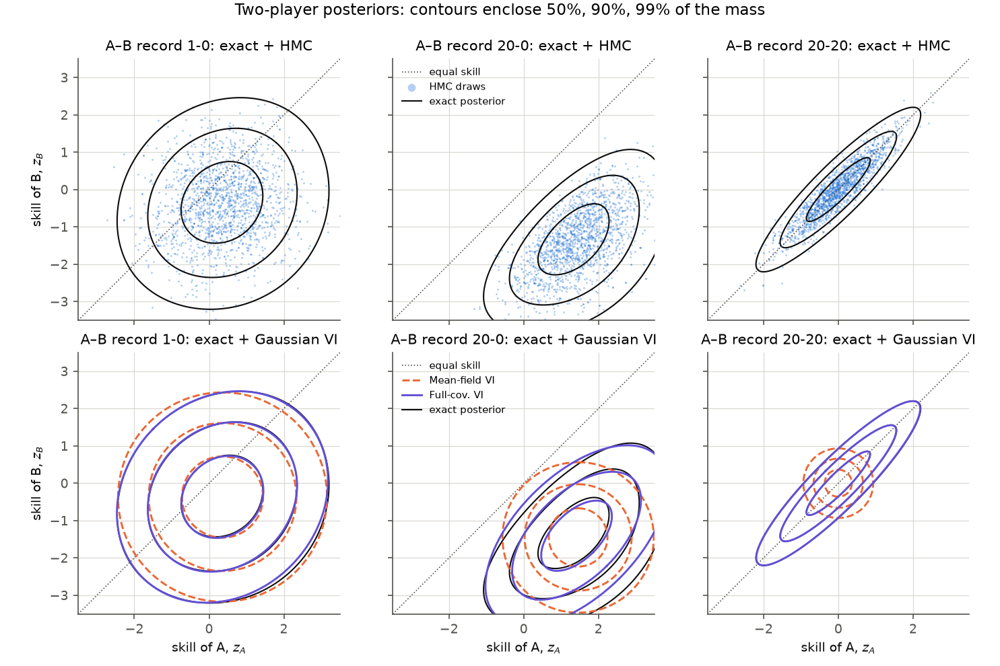
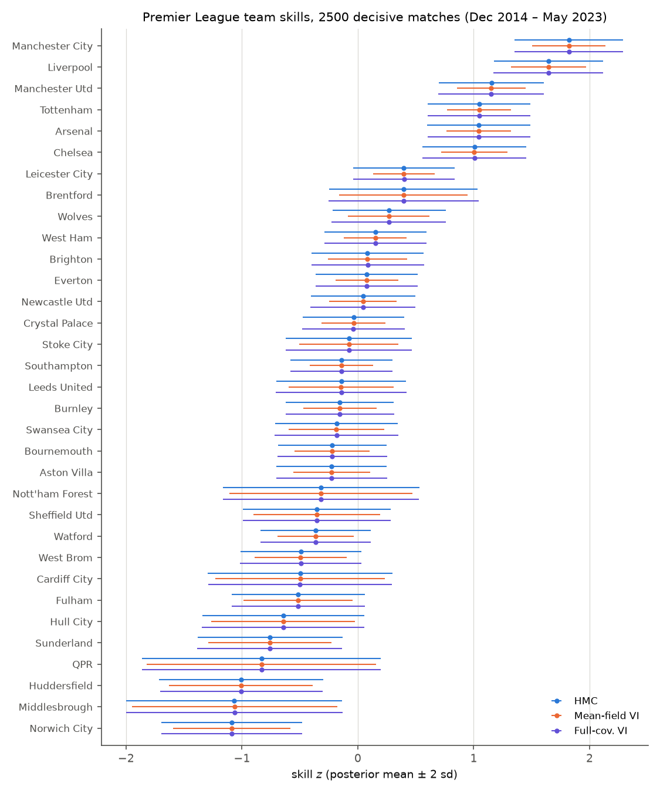
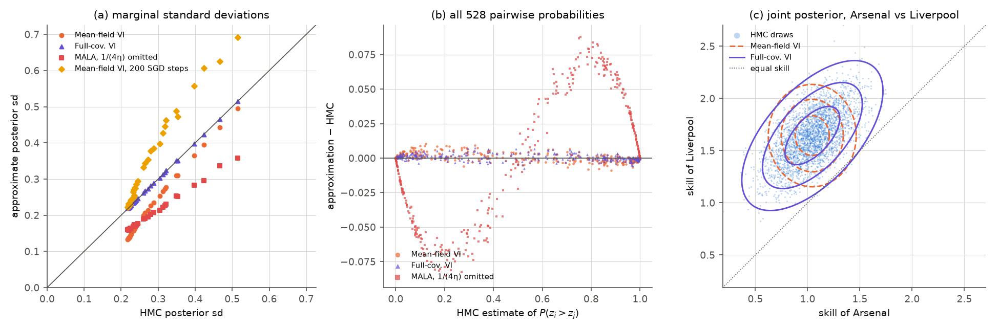
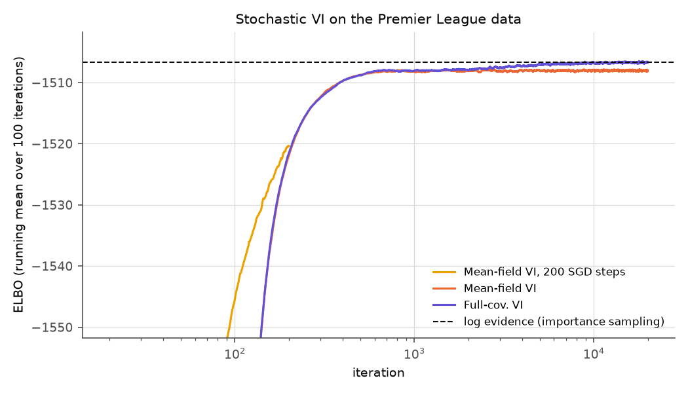
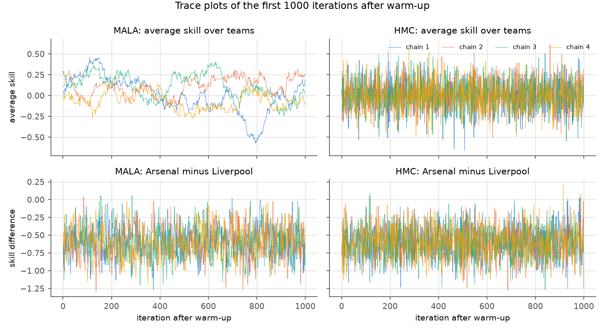
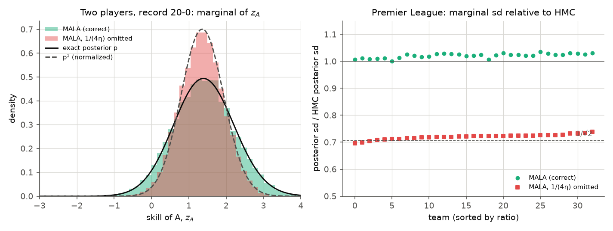

# How Much Does the Inference Algorithm Matter? MCMC and Variational Inference for TrueSkill Ratings of Premier League Teams

We fit a TrueSkill-style rating model with MALA, HMC, and mean-field and full-covariance Gaussian variational inference (VI). The data are 2,500 decisive Premier League matches and two-player data sets whose posteriors are known exactly. All correct, converged methods give the same ranking (Kendall τ = 1 against a long HMC run) and nearly the same pairwise win probabilities (mean absolute error ≤ 0.0017). Mean-field VI, however, understates marginal standard deviations by a median factor of 0.71, because it cannot represent the overall skill level, which only the prior identifies. Implementation errors matter more than the method. Omitting the 1/(4η) factor in MALA's acceptance ratio makes the chain sample about p², so every sd shrinks by about 1/√2. Stopping VI after 200 SGD steps leaves the ELBO 12.7 nats short and misranks 16 of 33 teams.

## Question

Every rating comes from an approximate posterior. Which conclusions depend on the algorithm: the ranking, pairwise comparisons ("is Arsenal better than Liverpool?"), or the uncertainty of each skill? How efficient are the samplers, and which implementation mistakes change the answers?

## Model and methods

**Model.** Team $i$ has skill $z_i\sim\mathcal N(0,1)$, independently, and beats team $j$ with probability $\sigma(z_i-z_j)=1/(1+e^{-(z_i-z_j)})$. Games are independent given $z$. With $W_{ij}$ the number of wins of $i$ over $j$,

$$\log p(z,\mathcal D)=-\tfrac12\lVert z\rVert^2-\tfrac N2\log 2\pi+\sum_{i,j}W_{ij}\log\sigma(z_i-z_j).$$

The likelihood is invariant to $z\mapsto z+c\mathbf 1$, so the data identify only differences. Two exact facts follow, and both serve as checks. (i) $\log p(z,\mathcal D)=-\tfrac N2\bar z^2+h(z-\bar z\mathbf 1)$, so the average skill $\bar z$ is independent of all differences and exactly $\mathcal N(0,1/N)$ a posteriori, with sd 0.1741 for $N=33$. (ii) Under a $\mathcal N(m\mathbf 1,I)$ prior the posterior is the $m=0$ posterior shifted by $m$.

**Exact posterior for two players.** A Riemann sum on an 801 × 801 grid over $[-6,6]^2$ gives means, covariances, $P(z_A>z_B)$, the log evidence, and $\mathrm{KL}(q\,\Vert\,p)$ for any Gaussian $q$.

**MALA.** The proposal is $z'=z+\eta\nabla\log p(z)+\sqrt{2\eta}\,\xi$ with $\xi\sim\mathcal N(0,I)$. It is accepted with probability $\min\{1,\,p(z')q(z\mid z')/(p(z)q(z'\mid z))\}$, where

$$\log q(z'\mid z)=-\frac{\lVert z'-z-\eta\nabla\log p(z)\rVert^2}{4\eta}+\text{const}.$$

*Pitfall.* Dropping $1/(4\eta)$ multiplies the Hastings correction by $4\eta$ (0.04 at $\eta=0.01$), so the correction almost vanishes. For small $\eta$ the Langevin proposal is nearly reversible for $p$, so the remaining filter $\min\{1,p(z')/p(z)\}$ makes the chain reversible for $p^2$. The reason is that $p^2(z)\,q(z'\mid z)\min\{1,p(z')/p(z)\}=p(z)q(z'\mid z)\min\{p(z),p(z')\}$ is symmetric. For a near-Gaussian posterior this halves every covariance. We run this variant at $\eta=0.01$ to measure the effect.

**HMC** uses $H(z,v)=-\log p(z)+\tfrac12\lVert v\rVert^2$ with an identity mass matrix, 15 leapfrog steps per iteration, a step size jittered by ±50 % against periodicity, and a Metropolis test on $H$. **Both samplers** run 4 chains started from prior draws, which are over-dispersed since posterior sds are 0.2–0.5. During warm-up, dual averaging (Hoffman and Gelman, 2014) tunes the step size toward the optimal acceptance rates: 0.574 for MALA (Roberts and Rosenthal, 1998) and 0.65 for HMC (Beskos et al., 2013). The step size is then frozen and warm-up is discarded. Each state is stored once. For each team we report split-$\hat R$ and the multi-chain ESS, computed with Geyer's initial monotone sequence as in Stan (Vehtari et al., 2021).

**Gaussian VI.** The family is mean-field, $\mathcal N(\mu,\mathrm{diag}\,\sigma^2)$, or full covariance, $\mathcal N(\mu,LL^\top)$. We maximize $\mathrm{ELBO}(q)=\mathbb E_q[\log p(z,\mathcal D)]+\mathcal H(q)$ with reparameterized draws $z=\mu+L\varepsilon$, the closed-form entropy, and Adam: 32 draws per step and 20,000 steps, with the learning rate decayed geometrically from 0.02 to $10^{-5}$. Since $z_i-z_j$ is Gaussian under $q$,

$$P(z_i>z_j)=\Phi\!\left(\frac{\mu_i-\mu_j}{\sqrt{\Sigma_{ii}+\Sigma_{jj}-2\Sigma_{ij}}}\right)\quad(\Sigma_{ij}=0\ \text{for mean-field});$$

under MCMC it is the fraction of draws with $z_i>z_j$. **Log evidence.** Importance sampling with the full-covariance fit as proposal ($2\times10^5$ draws) gives $\log p(\mathcal D)$, and hence $\mathrm{KL}(q\,\Vert\,p)=\log p(\mathcal D)-\mathrm{ELBO}(q)$.

## Experiments

**Data.** `data/premier-league-matches.csv` holds Premier League results from 1992/93 to 2022/23 (Kaggle dataset "Premier League Matches 1992–2022" by Evan Gower). Preprocessing:

- Draws (`FTR == "D"`) are dropped.
- The most recent 2,500 decisive matches in date order are kept: 20 Dec 2014 to 28 May 2023. This drops the 759 draws in that window.
- The 33 teams that appear are indexed alphabetically.
- Each match becomes a (winner, loser) pair. Home advantage is ignored; home teams won 58.5 % of the kept matches.

**Two-player data:** records 1–0, 20–0 (A won all 20), and 20–20.

| Method | Premier League | Two players |
|---|---|---|
| HMC (reference) | 4 chains × (1,000 warm-up + 20,000) | 4 × (500 + 2,500), 10 leapfrog steps |
| MALA (also with 1/(4η) omitted, fixed η = 0.01) | 4 × (2,000 + 40,000) | 4 × (1,000 + 10,000) |
| Mean-field / full-cov. VI | 20,000 Adam steps | 5,000 Adam steps |
| Mean-field VI, 200 SGD steps | momentum 0.9, learning rate 1e-4, 50 draws per step, start μ = 0, σ = 1 | – |

All random number generators are seeded.

## Results

### Two players, exact ground truth



*Exact posterior contours (black) with HMC draws (top) and Gaussian VI fits (bottom). In the 20–20 panel the full-covariance contours cover the exact ones.*

Sd of $z_A$ / correlation of $(z_A,z_B)$, from `results/toy_summary.csv`:

| Method | 1–0 | 20–0 | 20–20 |
|---|---|---|---|
| Exact (grid) | 0.932 / 0.15 | 0.809 / 0.53 | 0.724 / 0.91 |
| MALA | 0.937 / 0.14 | 0.811 / 0.54 | 0.717 / 0.91 |
| HMC | 0.936 / 0.14 | 0.815 / 0.54 | 0.720 / 0.91 |
| Mean-field VI | 0.921 / 0 | 0.667 / 0 | 0.308 / 0 |
| Full-covariance VI | 0.930 / 0.15 | 0.803 / 0.56 | 0.723 / 0.91 |
| MALA, 1/(4η) omitted | 0.655 / 0.19 | 0.580 / 0.52 | 0.514 / 0.90 |
| Exact $p^2$ (normalized) | 0.655 / 0.17 | 0.570 / 0.54 | 0.512 / 0.91 |
| KL(q ‖ p): mean-field / full-cov. | 0.012 / 0.0005 | 0.201 / 0.015 | 0.861 / 0.0001 |

- **Samplers.** Both agree with the grid up to Monte Carlo noise (sds within 2 %).
- **Mean-field VI** fails for correlated skills. After 20–20 the posterior is sure that $z_A\approx z_B$ but unsure of their common level; mean-field VI gives sd 0.31 against the true 0.72.
- **Full-covariance VI** misses only skewness, which shows up in tail probabilities. After 20–0, P(B is better) is $1.07\times10^{-6}$ exactly (confirmed by 1-D quadrature). Full-covariance VI gives $9.2\times10^{-5}$ and mean-field VI $1.0\times10^{-3}$.
- **The omitted-factor chain** reproduces the moments of $p^2$.

### Premier League

| (`results/methods.csv`) | HMC (ref.) | MALA | MALA, 1/(4η) omitted | Mean-field VI | Full-cov. VI | Mean-field, 200 SGD |
|---|---|---|---|---|---|---|
| Kendall τ vs HMC / teams ranked differently | 1 / 0 | 1 / 0 | 1 / 0 | 1 / 0 | 1 / 0 | 0.958 / 16 |
| max \|Δ mean\| vs HMC | – | 0.019 | 0.017 | 0.003 | 0.003 | 0.312 |
| median sd ratio, $z_i$ / $z_i-z_j$ | 1 / 1 | 1.024 / 0.999 | 0.722 / 0.737 | 0.709 / 1.007 | 1.003 / 0.999 | 1.184 / 1.647 |
| sd of average skill (exact 0.1741) | 0.1730 | 0.1816 | 0.1203 | 0.0413 | 0.1745 | 0.0645 |
| pairwise $P(z_i>z_j)$: mean / max abs. error | – | 0.0015 / 0.0145 | 0.0262 / 0.0878 | 0.0017 / 0.0105 | 0.0012 / 0.0074 | 0.0652 / 0.2549 |
| $P(z_{\text{Arsenal}}>z_{\text{Liverpool}})$ | 0.0017 | 0.0016 | 0.0001 | 0.0024 | 0.0019 | 0.0360 |
| KL(q ‖ p) [nats] | – | – | – | 1.31 | 0.007 | 12.66 |
| step size / acceptance rate | 0.138 / 0.66 | 0.0110 / 0.567 | 0.01 / 0.112 | – | – | – |
| max split-$\hat R$ / min ESS over teams | 1.0003 / 35,953 | 1.0039 / 611 | 1.016 / 306 | – | – | – |
| min ESS per second / per 1,000 gradients | 590.5 / 28.53 | 57.8 / 3.63 | 28.7 / 1.82 | – | – | – |
| ESS: average skill / Arsenal − Liverpool | 56,136 / 44,156 | 417 / 32,001 | 188 / 4,452 | – | – | – |
| wall time [s] | 60.89 | 10.56 | 10.67 | 19.85 | 20.96 | 0.26 |



*Posterior mean ± 2 sd per team. The means agree; mean-field intervals are narrower.*



*(a) Marginal sds against HMC. (b) Error of all 528 pairwise probabilities. (c) Arsenal against Liverpool: HMC draws and the 50/90/99 % regions of both VI fits.*

**Rankings and comparisons are robust.** Every converged method orders the teams identically. All pairwise probabilities agree with HMC within 0.015, which is about the samplers' Monte Carlo error.

Mean-field VI understates marginal sds (median ratio 0.709) but gets the sds of differences right (1.007). What it misses is the shared level. Its sd of the average skill is 0.041, against the exact 0.174, and the shared level cancels in every comparison. HMC, MALA and full-covariance VI recover it (0.173, 0.182, 0.175).

**The unconverged fit** (ELBO still rising, 12.66 nats below the log evidence of −1506.72; importance-sampling ESS 193,436 of 200,000) has three problems:
- its sds are inflated from the initial σ = 1;
- sparsely observed teams are shrunk toward 0 (QPR −0.52 against −0.83);
- some pairwise probabilities are off by 0.25.

Its top ten is still the right set. Leicester (7th) and Brentford (8th) are in the top ten under every method. HMC gives them top-ten probabilities of 0.95 and 0.79. Brentford, with only 55 decisive matches, has a 90 % rank interval of 7–16. Their places follow from win rates of 52 % and 51 % behind six clubs at 68–82 %; they are not an optimizer artifact.



*ELBO during optimization (running mean). Full-covariance VI ends 0.007 nats below the log evidence and mean-field VI 1.31 nats below.*



**Sampler efficiency.** MALA mixes slowly only along the average skill. In that direction the target is the unit-variance prior, which Langevin steps need about $1/\eta\approx90$ iterations to explore. Skill differences mix well (ESS 32,001). On the worst coordinate HMC is about 10 times more efficient per second and 8 times per gradient.

### Pitfalls and the prior shift



*Left: with 1/(4η) omitted, the marginal of $z_A$ (20–0) matches $p^2$, not $p$. Right: on the real data every sd shrinks by 0.70–0.74 (median 0.722), close to $1/\sqrt2$.*

The omitted-factor chain ranks correctly but is overconfident: its pairwise errors reach 0.088.

**Prior shift.** A $\mathcal N(5,1)$ prior moves both exact two-player means by exactly 5.000000 and leaves the sds and $P(z_B>z_A)=1.07\times10^{-6}$ unchanged. On the real data a mean-field refit from μ = 0, with new random draws, moves every mean by 5 within 0.002. Sds change by at most 0.0008 and pairwise probabilities by at most 0.003, which is SVI noise (`results/prior_shift.json`).

## Discussion

For comparing teams, the choice among correct, converged methods hardly matters. Mean-field VI is adequate for comparisons. Its intervals for single skills, however, are about 30 % too narrow, and so is anything built from them, such as $P(z_i>0)$.

This is structural. The negative Hessian of the log posterior is the identity plus a weighted graph Laplacian. The mean-field optimum of a Gaussian matches only the diagonal of the precision, so it loses the common-mode variance that the Laplacian leaves to the prior. A full-covariance Gaussian is nearly exact; its remaining error is skewness, which affects only tail probabilities.

Implementation errors are the larger risk. A missing proposal-density factor gives a well-mixing chain (split-$\hat R$ below 1.03) with the wrong target. Diagnostics cannot catch this; exact checks can, such as the two-player grid or the $\mathcal N(0,1/N)$ law of the average skill. An unconverged ELBO gives a plausible ranking with wrong uncertainties. Storing states twice, running one chain from zero, or skipping warm-up does not bias averages, but it misstates precision and leaves no diagnostics.

*Limitations.* The analysis ignores draws (23 % of matches in the window) and home advantage. It holds skills constant over about eight and a half seasons. The prior sd of 1 sets how strongly teams with few matches are shrunk. The samplers use an identity mass matrix, and there is a single data set.

## Related work

The model is Bradley–Terry (Bradley and Terry, 1952) with a Gaussian prior. TrueSkill (Herbrich et al., 2007) instead uses a probit link, models draws, and runs approximate message passing. MALA dates to Roberts and Tweedie (1996), and HMC to Duane et al. (1987) (see Neal, 2011).

Two later methods address the tuning seen here:
- **NUTS** (Hoffman and Gelman, 2014) sets trajectory lengths automatically and introduced dual averaging.
- **L2HMC** (Levy et al., 2018) learns a neural-network generalization of the leapfrog integrator and reports large ESS gains on ill-conditioned targets.

Diagnostics follow Gelman and Rubin (1992), Geyer (1992) and Vehtari et al. (2021). Reparameterization-gradient VI is due to Kingma and Welling (2014), Rezende et al. (2014) and Titsias and Lázaro-Gredilla (2014). ADVI (Kucukelbir et al., 2017) offers mean-field and full-rank Gaussians. Bishop (2006, §10.1.2) and Blei et al. (2017) discuss how mean-field approximations underestimate variance.

## Reproduce

```bash
cd projects/04-trueskill-premier-league
python run.py --threads 2     # full run: all figures and results/, about 3 min (180.5 s) on an Apple-silicon laptop
python run.py --quick         # smoke run, ~10x fewer iterations, about 35 s (overwrites figures/ and results/)
python -m pytest -q tests     # 26 tests, about 25 s
```

Hyperparameters are command-line options (`python run.py --help`). Wall times vary by machine. Every other number is fixed by the seeds.

## Related notes

In the [lecture notes](../../notes/STA314_STA414_Statistical_ML_Lecture_Notes.pdf):

- Chapter 14: TrueSkill as the running example, Metropolis–Hastings, HMC and the Langevin remark, $\hat R$ and ESS.
- Chapter 15: KL divergence, mean field, ELBO, the reparameterization trick, VI versus MCMC.
- Chapter 2: the multivariate Gaussian, which gives $P(z_i>z_j)$.

## References

- Beskos, A., et al. (2013). Optimal tuning of the hybrid Monte Carlo algorithm. *Bernoulli* 19(5A), 1501–1534.
- Bishop, C. M. (2006). *Pattern Recognition and Machine Learning*. Springer.
- Blei, D. M., Kucukelbir, A., and McAuliffe, J. D. (2017). Variational inference: A review for statisticians. *JASA* 112(518), 859–877.
- Bradley, R. A., and Terry, M. E. (1952). Rank analysis of incomplete block designs: I. The method of paired comparisons. *Biometrika* 39(3/4), 324–345.
- Duane, S., et al. (1987). Hybrid Monte Carlo. *Physics Letters B* 195(2), 216–222.
- Gelman, A., and Rubin, D. B. (1992). Inference from iterative simulation using multiple sequences. *Statistical Science* 7(4), 457–472.
- Geyer, C. J. (1992). Practical Markov chain Monte Carlo. *Statistical Science* 7(4), 473–483.
- Herbrich, R., Minka, T., and Graepel, T. (2007). TrueSkill™: A Bayesian skill rating system. *NeurIPS 19*.
- Hoffman, M. D., and Gelman, A. (2014). The No-U-Turn Sampler. *JMLR* 15, 1593–1623.
- Kingma, D. P., and Welling, M. (2014). Auto-encoding variational Bayes. *ICLR*.
- Kucukelbir, A., et al. (2017). Automatic differentiation variational inference. *JMLR* 18(14), 1–45.
- Levy, D., Hoffman, M. D., and Sohl-Dickstein, J. (2018). Generalizing Hamiltonian Monte Carlo with neural networks. *ICLR*.
- Neal, R. M. (2011). MCMC using Hamiltonian dynamics. In *Handbook of Markov Chain Monte Carlo*, ch. 5. CRC Press.
- Rezende, D. J., Mohamed, S., and Wierstra, D. (2014). Stochastic backpropagation and approximate inference in deep generative models. *ICML*.
- Roberts, G. O., and Rosenthal, J. S. (1998). Optimal scaling of discrete approximations to Langevin diffusions. *JRSS B* 60(1), 255–268.
- Roberts, G. O., and Tweedie, R. L. (1996). Exponential convergence of Langevin distributions and their discrete approximations. *Bernoulli* 2(4), 341–363.
- Titsias, M., and Lázaro-Gredilla, M. (2014). Doubly stochastic variational Bayes for non-conjugate inference. *ICML*.
- Vehtari, A., et al. (2021). Rank-normalization, folding, and localization: An improved $\hat R$ for assessing convergence of MCMC. *Bayesian Analysis* 16(2), 667–718.
