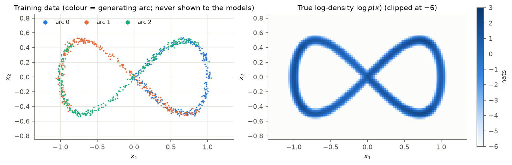
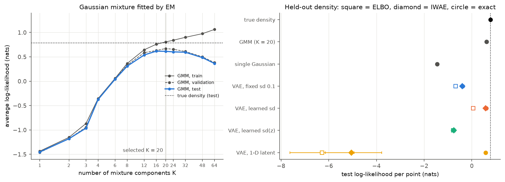
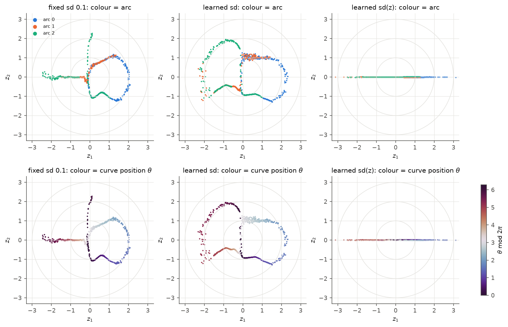
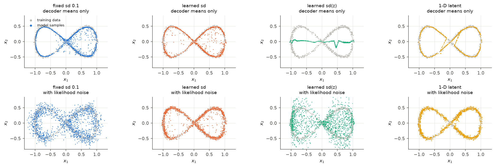
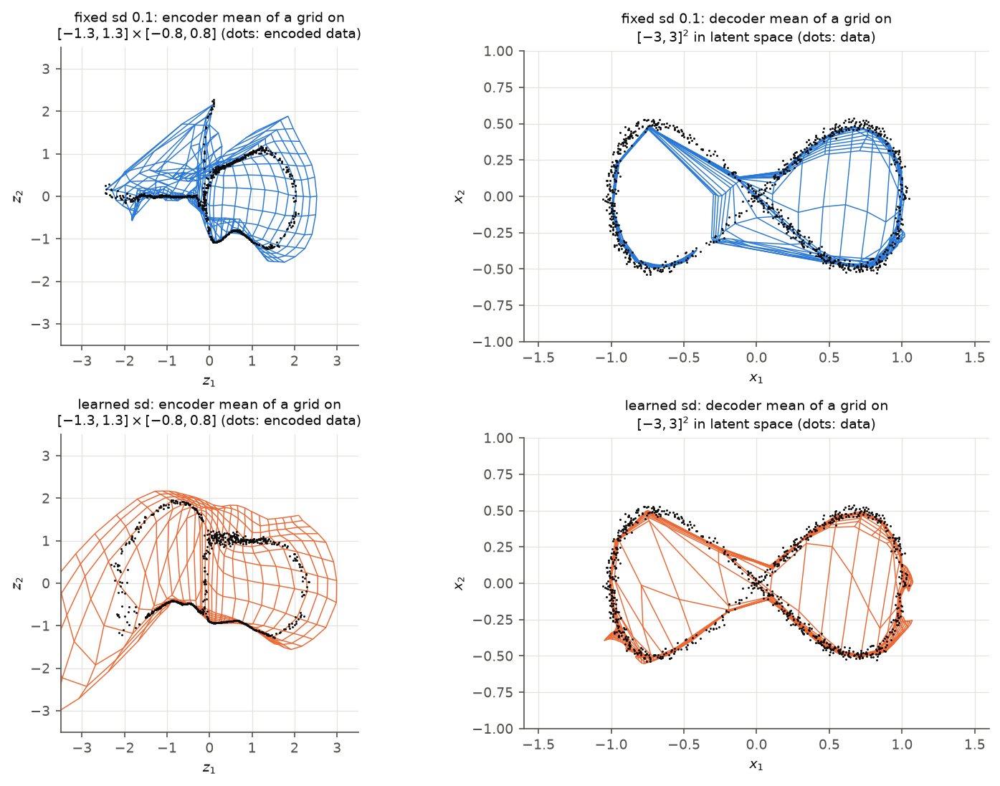
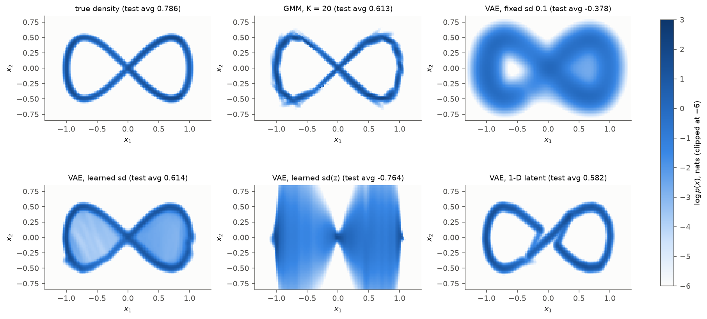
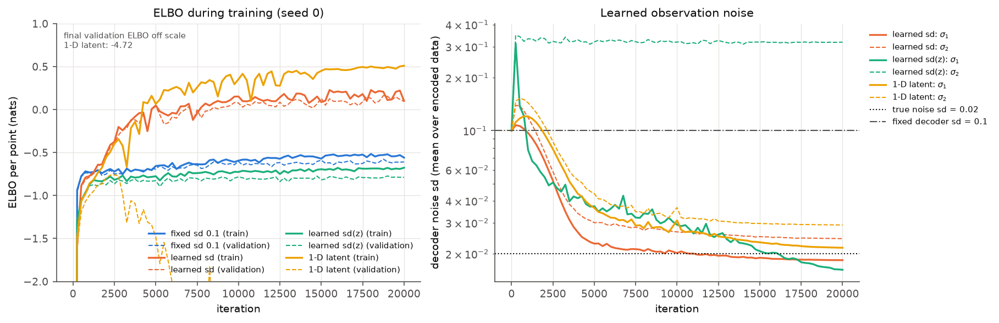
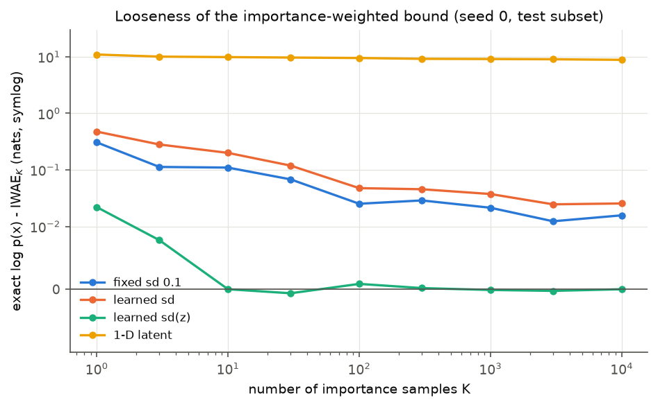
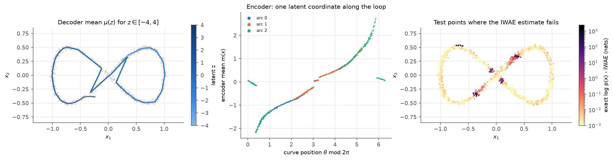

# What does a VAE learn on a noisy figure eight, and how good a density model is it?

We train variational autoencoders (VAEs) on 900 points scattered around a figure-eight curve, a distribution whose density we can compute exactly, and score them as density models on 3,000 held-out points with three estimators of $\log p(x)$: the ELBO, the importance-weighted bound (IWAE, $K=5000$) and an exact quadrature over the latent space. With a learned observation noise, a 2-D-latent VAE reaches **0.606** nats per point (true density: **0.786**), on par with a validation-selected Gaussian mixture (0.613). Fixing the decoder noise at sd 0.1, five times the true noise of 0.02, costs about one nat (−0.383). Two ablations show how it fails: a per-$z$ noise output treats the second coordinate as noise in all three seeds (−0.760), and a 1-D latent gives a good density (0.580) whose held-out ELBO and IWAE are off by more than 5 nats, because the encoder sends some test points to the wrong part of the curve.

## Question

1. What representation does a VAE learn when the data are a closed, self-crossing 1-D curve in the plane, generated from three overlapping arcs whose labels the model never sees?
2. How good is the VAE as a density model, compared with the true density, a single Gaussian and a Gaussian mixture fitted by EM, and how much does the answer depend on how $\log p(x)$ is estimated?

## Model and methods

**Data.** A point is generated as $c\sim\mathrm{Unif}\{0,1,2\}$, $\theta\sim\mathrm{Unif}[2\pi c/3,\ 2\pi c/3+\pi]$, $x=f(\theta)+0.02\,\varepsilon$ with $\varepsilon\sim\mathcal N(0,I_2)$ and $f(\theta)=(\sin\theta,\ \sin\theta\cos\theta)$. The curve $f$ is a figure eight that crosses itself at the origin. The three arcs have length $\pi$ on a curve of period $2\pi$, so half of the curve is covered by two arcs: the arc labels are not separable clusters. Because the noise is isotropic, the true density is a 1-D integral,
$$p(x)=\frac{1}{3\pi}\sum_{c=0}^{2}\int_{\text{arc }c}\mathcal N\big(x;f(\theta),0.02^2 I\big)\,d\theta ,$$
evaluated by composite Gauss–Legendre quadrature (converged to $10^{-8}$ nats).

**VAE.** Prior $p(z)=\mathcal N(0,I_d)$, decoder $p_\theta(x\mid z)=\mathcal N\big(\mu_\theta(z),\operatorname{diag}\sigma^2\big)$, encoder $q_\phi(z\mid x)=\mathcal N\big(m_\phi(x),\operatorname{diag}s_\phi(x)^2\big)$; both networks are ReLU MLPs with hidden widths 100 and 50. Training maximizes the average
$$\mathrm{ELBO}(x)=\mathbb E_{q_\phi(z\mid x)}\big[\log p_\theta(x\mid z)\big]-\mathrm{KL}\big(q_\phi(z\mid x)\,\|\,p(z)\big),$$
with the reparameterization $z=m_\phi(x)+s_\phi(x)\odot\varepsilon$ (one sample per point) and the KL term in closed form, $\tfrac12\sum_j(m_j^2+s_j^2-1-\log s_j^2)$. The four variants share everything except:

| variant | latent dim | decoder noise |
|---|---|---|
| fixed sd 0.1 | 2 | $\sigma=0.1$, not trained |
| learned sd | 2 | one trained $\sigma_j$ per coordinate |
| learned sd(z) | 2 | $\log\sigma(z)$ is a decoder output (heteroscedastic) |
| 1-D latent | 1 | one trained $\sigma_j$ per coordinate |

**Three estimates of $\log p(x)$.** For any $q$,
$$\mathrm{ELBO}(x)\ \le\ \mathrm{IWAE}_K(x)=\mathbb E\Big[\log\tfrac1K\textstyle\sum_{k=1}^K w_k\Big]\ \le\ \log p(x),\qquad w_k=\frac{p(z_k)\,p_\theta(x\mid z_k)}{q_\phi(z_k\mid x)},\ z_k\sim q_\phi(\cdot\mid x),$$
and $\mathrm{IWAE}_K\to\log p(x)$ as $K\to\infty$. Because the latent space has at most two dimensions, we can also compute $\log p(x)=\log\int\mathcal N(z;0,I)\,p_\theta(x\mid z)\,dz$ directly by a midpoint rule: a $640\times640$ grid on $[-5,5]^2$ restricted to the disk of radius 5 for $d=2$, and 8,000 points on $[-5,5]$ for $d=1$. This "exact" value uses only the decoder, so it does not depend on how good the encoder is. Doubling the grid changes the mean over 200 test points by less than $5\times10^{-4}$ nats for every model (largest single-point change 0.10 nats).

**Baselines.** A maximum-likelihood Gaussian, and Gaussian mixtures with full covariances fitted by EM (k-means++ initialization, best of 5 restarts) for $K\in\{1,2,3,4,6,8,12,16,20,24,32,48,64\}$, with $K$ chosen on a validation set. The M-step uses $\Sigma_k=(S_k+10^{-6}I)/N_k$, which is the exact maximizer under the penalty $-\tfrac{10^{-6}}{2}\operatorname{tr}\Sigma_k^{-1}$, so EM still increases its objective monotonically.

## Experiments

Training, validation and test sets have 300, 300 and 1,000 points per arc (900 / 900 / 3,000), drawn with data seed 0 and saved to `data/`. Each VAE is trained for 20,000 full-batch Adam steps, learning rate $3\times10^{-3}$ with cosine decay to $3\times10^{-5}$, with seeds 0, 1, 2. The ELBO is evaluated with 100 samples per point, the IWAE with $K=5000$, and the IWAE-versus-$K$ curve on the first 500 test points. Figures show seed 0; tables report the mean over seeds, with the range in `results/vae_runs.csv`.

**Tests** (23 pytest checks) compare each routine with an independent reference: KL against Monte Carlo; the sampler's moments and pathwise gradients; on a linear-Gaussian VAE (probabilistic PCA, exact marginal) the identity $\log p(x)-\mathrm{ELBO}=\mathrm{KL}(q\,\|\,p(z\mid x))$, tight bounds at the exact posterior, $\mathrm{IWAE}_K\uparrow\log p(x)$, and the latent quadrature; EM's monotone objective and parameter recovery; and the true density's normalization and agreement with empirical frequencies.

## Results



*Training data coloured by generating arc (left) and the true log-density (right). The arcs overlap on half of the curve.*

| model | train (exact) | test ELBO | test IWAE$_{5000}$ | test exact |
|---|---|---|---|---|
| true density | 0.757 | | | **0.786** |
| single Gaussian | −1.434 | | | −1.451 |
| GMM, $K=20$ (val.-selected) | 0.807 | | | 0.613 |
| VAE, fixed sd 0.1 | −0.367 | −0.675 | −0.396 | −0.383 |
| VAE, learned sd | 0.669 | 0.060 | 0.580 | **0.606** |
| VAE, learned sd(z) | −0.679 | −0.781 | −0.760 | −0.760 |
| VAE, 1-D latent | 0.628 | −6.287 | −5.043 | 0.580 |

*Average log-likelihood per point in nats (VAE: mean of 3 seeds; `results/density_comparison.csv`). Across seeds, the exact test value of each VAE varies by 0.007 to 0.050 nats.*



*Left: GMM log-likelihood versus number of components; validation selects $K=20$, beyond which the mixture overfits. Right: test log-likelihood of every model. For each VAE: ELBO (square), IWAE (diamond), exact quadrature (circle); bars span the three seeds.*



*Encoder means of the training data, coloured by arc (top) and by curve position $\theta$ (bottom); grey circles are prior contours.*



*1,500 samples from each model. Top: decoder means $\mu_\theta(z)$, $z\sim p(z)$. Bottom: full samples $x\sim p_\theta(x\mid z)$, which include the likelihood noise.*



*Left: the encoder mean applied to a regular grid in data space. Right: the decoder mean applied to a regular grid in latent space.*



*Log-density maps (seed 0). The VAE maps are the exact quadrature.*



*Left: training (solid) and validation (dashed) ELBO. Right: the learned decoder noise sd per coordinate; the true noise sd is 0.02.*



*Gap between the exact $\log p(x)$ and $\mathrm{IWAE}_K$ on 500 test points.*



*1-D latent VAE. Left: the decoder curve $\mu_\theta(z)$. Middle: encoder mean versus curve position. Right: test points coloured by the gap between the exact $\log p(x)$ and IWAE$_{5000}$.*

## Discussion

**What the VAE learns.** The arc labels do not form clusters in the latent space, and they could not: half of the curve carries two labels. The encoder recovers the position along the curve: in the learned-sd model the encoded points lie on a few smooth 1-D pieces along which $\theta$ varies continuously, and the curve is cut where the colour jumps between pieces. The decoder folds the Gaussian latent plane onto the thin curve; prior mass between branches is mapped to "bridges" across the loops, visible in the decoder grid warp, as stray decoder means and as faint density inside the loops. Both latent dimensions stay active (average KL 3.3 and 1.4 nats).

**The noise variance is part of the density model.** Fixing $\sigma=0.1$ blurs the curve to five times its true width. The decoder means still trace the curve, so plotting them alone hides the problem; the full samples are a cloud, and the held-out log-likelihood is about one nat worse than with a learned $\sigma$, which recovers the true noise level ($\hat\sigma=0.019$ and $0.024$).

**A heteroscedastic decoder can give up on a coordinate.** With $\log\sigma(z)$ as a network output, all three seeds converge to $\sigma_2(z)\approx0.32$, close to the marginal sd of $x_2$ (0.35): the decoder means collapse to a nearly flat line, $x_2$ is explained as noise, and the second latent dimension is unused (KL below $10^{-4}$ nats). The result (−0.760) is worse than a fixed $\sigma=0.1$. A likely mechanism: the gradient of the Gaussian log-likelihood with respect to the mean is scaled by $1/\sigma^2$, so once $\sigma_2$ jumps to about 0.3 in the first few hundred steps, the mean of $x_2$ receives little signal. We did not try remedies such as a warm-up with a shared $\sigma$.

**A good density can have useless bounds.** The 1-D-latent VAE matches the intrinsic dimension of the data, and its exact test log-likelihood (0.580) is close to the 2-D model's. But its encoder must cut the closed curve: the encoder mean jumps at a few places, and the decoder curve takes shortcuts near the crossing. Training points near the cuts are fitted, while test points between them are encoded far from where the decoder explains them; for 3.2% of test points the IWAE is more than 1 nat below the exact value. There $q_\phi$ misses the posterior and no realistic $K$ helps (on the 500-point subset the IWAE is still 8.8 nats below the exact value at $K=10^4$). The train ELBO (0.505) is close to the exact value (0.628) but the test ELBO is −6.3, so a bound-based comparison would rank this model last although its decoder is one of the better densities. For the 2-D models the IWAE is within 0.03 nats of the exact value, but the learned-sd ELBO is 0.55 nats below it, likely because the posterior of a decoder that folds the plane onto a curve is a thin curved sliver that a diagonal Gaussian cannot fit.

**VAE versus classical density estimators.** On 900 points in two dimensions, a 20-component Gaussian mixture is as good as the best VAE (0.613 versus 0.606), and both are about 0.18 nats below the true density. The mixture's training log-likelihood (0.807) exceeds the true density's on the same points (0.757), so the remaining gap is mostly estimation error from the small sample.

**Limitations.** One synthetic dataset, one architecture, three seeds and a fixed training budget; no hyperparameter search for the VAEs. The exact quadrature is only practical because the latent space has at most two dimensions.

**Methodological notes.** (i) VAE samples must include the likelihood noise; decoder means alone are not samples from $p_\theta(x)$. (ii) A fixed decoder variance is a modelling choice, not only a stabilizer, and should match the noise in the data. (iii) In grid-warp plots, the encoder maps data space to latent space and the decoder maps latent space to data space. (iv) Averaging $\log p(x,z)-\log q(z\mid x)$ over samples and using the closed-form KL are both unbiased ELBO estimators (tested); the latter has lower variance.

## Reproduce

```bash
cd projects/05-vae-figure-eight
python run.py              # full run: 381 s on an Apple Silicon laptop (default --workers 2)
python run.py --quick      # smoke run: about 20 s
python -m pytest -q tests  # 23 tests: about 15 s
```

`run.py` regenerates `data/*.csv`, every figure in `figures/` and every number in `results/` (`summary.json`, `density_comparison.csv`, `vae_runs.csv`, `gmm_selection.csv`, `iwae_convergence.csv`). All seeds are fixed, and each VAE run uses one thread, so the results do not depend on `--workers`. The `--quick` run writes to the same files, so rerun the full command afterwards. Hyperparameters are command-line options (`python run.py --help`).

## Related notes

In the [lecture notes](../../notes/STA314_STA414_Statistical_ML_Lecture_Notes.pdf): Chapter 16 (Gaussian mixtures and EM, probabilistic PCA, variational autoencoders and amortized inference), Chapter 15 (KL divergence, the ELBO and the reparameterization trick) and Chapter 14 (importance sampling, the idea behind the IWAE bound).
